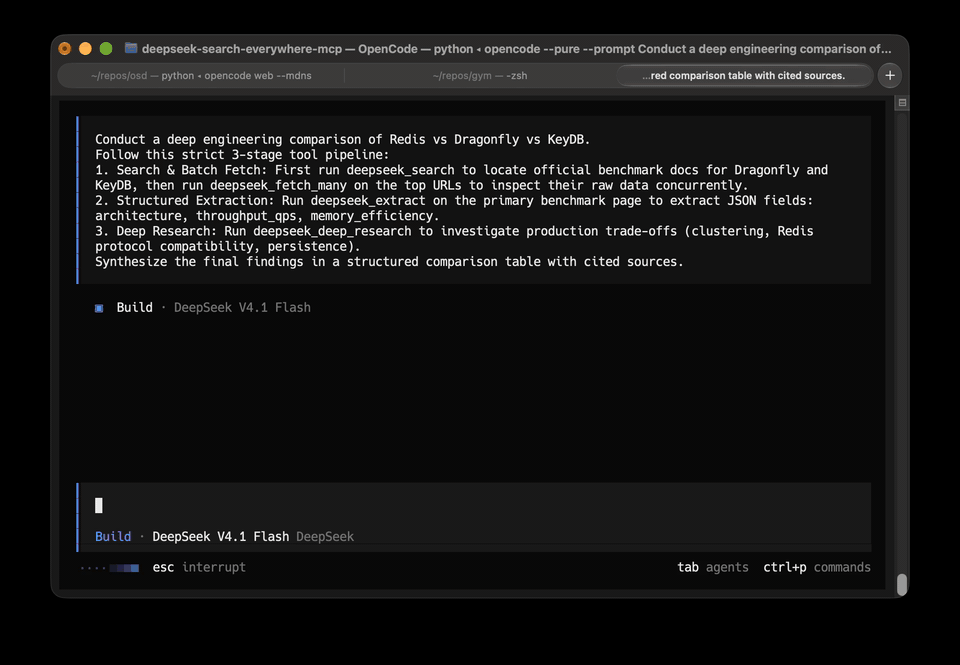

<p align="center">
  
</p>

# DeepSeek Search Everywhere MCP

<p align="center">
  <a href="https://pypi.org/project/deepseek-search-everywhere-mcp/"></a>
  <a href="https://pypistats.org/packages/deepseek-search-everywhere-mcp"></a>
  <a href="https://pypi.org/project/deepseek-search-everywhere-mcp/"></a>
  <a href="https://registry.modelcontextprotocol.io"></a>
  <a href="https://github.com/radoxtech/deepseek-search-everywhere-mcp/actions/workflows/ci.yml"></a>
  <a href="LICENSE"></a>
  <a href="https://glama.ai/mcp/servers/radoxtech/deepseek-search-everywhere-mcp"></a>
  <a href="https://m8ven.ai/mcp/radoxtech-deepseek-search-everywhere-mcp-z1tjri?s=readme"></a>
</p>

**DeepSeek Search Everywhere** is a [Model Context Protocol (MCP)](https://modelcontextprotocol.io) server that gives AI agents web search, page fetch (web scraping to clean Markdown), structured data extraction and deep research with numbered citations, all through the DeepSeek Search & Fetch API. It runs over stdio or authenticated HTTP and works with Claude Code, Claude Desktop, Cursor, Cline, Windsurf, Zed, OpenCode and any other MCP client.

You need one credential, a DeepSeek API key, and you pay DeepSeek directly per request: there is no separate subscription. It is an alternative to Tavily, Perplexity, Firecrawl and Exa for agents that need live web access, and about 10x–13x cheaper than Tavily and Firecrawl for search and fetch; see [Comparison](#comparison-with-tavily--firecrawl) for the numbers.

<!-- mcp-name: io.github.radoxtech/deepseek-search-everywhere-mcp -->

> Not affiliated with DeepSeek. This is an independent, community-maintained project.

## Demo

<p align="center">
  
</p>
<p align="center">
  <em>OpenCode calling <code>deepseek_search</code>, <code>deepseek_fetch</code>, <code>deepseek_extract</code> and <code>deepseek_quick_research</code>. The same tools work in every MCP client.</em>
</p>

## Key features

- **Web search** with snippets or full page text, domain and date filters, language selection and optional query rewrite.
- **Page fetch to Markdown** for one URL or up to 10 in parallel, with section, snippet, offset and find-text selectors for long pages.
- **Structured extraction**: pull named fields or a JSON schema from a page; each value must be backed by a verbatim quote from the page or it is returned as `null`.
- **Deep research with citations**: fast single-pass research (`deepseek_quick_research`, depths `low`/`medium`/`high`) and autonomous multi-round agent (`deepseek_deep_agent_research`, depths `medium`/`high`/`max`) with `academic`/`technical` source modes. Reports carry `[n]` citations mapped to a `sources` array with number verification. Server-side synthesis or client-side synthesis (`synthesis="client"`). See [Deep research](#deep-research).
- **Grounded in scientific IR & algorithms**: Reciprocal Rank Fusion (RRF), Maximal Marginal Relevance (MMR), BM25 lexical proximity windows, sequential analysis stopping criteria, and token bucket traffic shaping. See [Scientific methods & algorithms](#scientific-methods--algorithmic-architecture).
- **Cost reporting**: every response carries `cost_usd` and, where an LLM is involved, `cost_breakdown`; an optional daily budget blocks overspending.
- **Hardened against prompt injection**, with an egress guard, static SSRF filtering and no telemetry. See [Security](#security).
- **Small footprint**: pure Python, no local browser, `uvx` zero-install, 7 tools.

## Tools

| Tool | What it does | Key parameters |
|---|---|---|
| `deepseek_search` | Search the web for one query or up to 5 in parallel; returns ranked results with snippets or full page text | `query` (str or list of up to 5), `count` (1-50, default 5), `content` (`snippets` or `full`), `lang`, `refresh` |
| `deepseek_fetch` | Fetch one known URL or up to 10 in parallel as clean Markdown | `url` (str or list of up to 10), `query` (optional matching excerpts), `max_chars`, `refresh` |
| `deepseek_extract` | Extract structured JSON from one page or up to 10 in parallel, backed by verbatim quotes | `url` (str or list of up to 10), `fields` or `schema`, `instruction`, `refresh` |
| `deepseek_quick_research` | Fast single-pass deep research across multiple search angles: searches, reads sources and writes a cited report (~25–35s) | `topic` (max 4000 chars), `depth` (`low`, `medium`, `high`; default `medium`), `sources` (`any`, `academic`, `technical`; default `any`), `lang`, `synthesis` (`server` or `client`; default `server`), `refresh` |
| `deepseek_deep_agent_research` | Autonomous multi-round deep research agent: plans aspects, audits evidence, queries gaps and autostops when rounds saturate (~45–90s) | `topic` (max 4000 chars), `depth` (`medium`, `high`, `max`; default `medium`), `sources` (`any`, `academic`, `technical`; default `any`), `lang`, `refresh` |
| `deepseek_check_research` | Poll a running research job, read client-synthesis sources page by page, or submit your report for verification | `job_id`, `page`, `answer` |
| `deepseek_check_balance` | Read-only: DeepSeek account balance and session metrics | none |

Details that matter when calling the tools:

- `query` is limited to 128 characters and accepts search operators like `site:`, `-site:`, `"phrase"`, and `lang:`. When passing a list of queries, up to 5 run concurrently; duplicates run once, extras are listed in `skipped_queries`.
- `content="snippets"` (default) returns a short snippet per result; `content="full"` returns page text and fetches pages whose search content is missing, one extra request per fetched page, which is reflected in `requests_used` and `cost_usd`.
- `deepseek_fetch` takes a single URL or a list of up to 10 URLs. Passing `query=` returns focused lexical excerpts around matching terms without an LLM call. Content is sanitized (images neutralized, hidden text stripped).
- `deepseek_extract` takes either `fields` (list of names) or `schema` (JSON schema), never both. Fields whose evidence quote cannot be found in the page are set to `null` with a note; `extraction_truncated` is raised when the model output was cut off.
- `lang` is an ISO code such as `en`, `de`, `pl`. For global tech and science, prefer `lang="en"`; use local country codes for domestic laws, taxes, or local institutions. The final report is always synthesized in the language of the topic prompt.
- `strip_boilerplate=true` removes known site interface text (for example localized Reddit UI and cookie-consent dialogs) without touching article text or code blocks.

Example calls:

```text
deepseek_search(query="rust async runtime comparison", count=5)
deepseek_search(query=["tokio runtime", "async-std vs smol"])
deepseek_fetch(url="https://docs.rs/tokio/latest/tokio/", max_chars=15000)
deepseek_fetch(url="https://example.com/long-article", query="rate limits")
deepseek_fetch(url=["https://example.com/a", "https://example.com/b"])
deepseek_extract(url="https://news.ycombinator.com", fields=["top_story", "points", "author"])
deepseek_quick_research(topic="Raft vs Paxos consensus: trade-offs in practice", depth="medium")
deepseek_deep_agent_research(topic="Evaluation of small modular reactor designs: BWRX-300 vs Rolls-Royce SMR", depth="high")
deepseek_check_research(job_id="<job_id from a running response>")
deepseek_check_balance()
```

## How agents should use this server

Pick the tool by what the task needs:

| Task | Tool | Recommended When |
|---|---|---|
| Fast single-pass research report with citations (~25–35s) | `deepseek_quick_research` | Technical documentation, specifications, architecture comparisons, rapid factual synthesis |
| Flagship autonomous deep investigation with gap detection (~45–90s) | `deepseek_deep_agent_research` | In-depth investigations, comprehensive state-of-the-art reports, contested disputes, and uncovering hidden details |
| One fact, a recent event, a page to find (or up to 5 queries in parallel) | `deepseek_search` (snippets first, `content="full"` only when page text is needed) |
| A known URL or batch of up to 10 URLs | `deepseek_fetch`; pass `query=` to get only the relevant excerpts |
| Specific fields or a JSON schema from a page or batch of pages | `deepseek_extract` |
| Poll running research or submit client synthesis report | `deepseek_check_research` |
| Account balance and session usage | `deepseek_check_balance` |

Research jobs have three states, and the response says which one applies:

- `status: "done"`: the report is in `report` and its `[n]` citations are the `id`s in `sources`.
- `status: "running"`: call `deepseek_check_research(job_id)` until it is done; do not start the same research again.
- `status: "needs_input"` (only with `synthesis="client"`): read the sources (`context`, further pages with `page=`), write the report and send it with `deepseek_check_research(job_id, answer=...)`.

Common mistakes to avoid: a query must fit in 128 characters; parallel `deepseek_search` runs at most 5 unique queries and lists the rest in `skipped_queries`; check `partial` on batch results, because `ok` stays `true` when single items fail. The [error codes](docs/configuration.md#4-closed-error-codes) table says which errors are worth retrying.

## Quick start

1. Create a DeepSeek API key at [platform.deepseek.com](https://platform.deepseek.com) and add a small balance.
2. Install [uv](https://docs.astral.sh/uv/) (or use `pip`; Python 3.12 or newer is required).
3. Add the server to your MCP client. The minimal configuration is:

```json
{
  "mcpServers": {
    "deepseek-search-everywhere": {
      "command": "uvx",
      "args": ["deepseek-search-everywhere-mcp"],
      "env": { "DEEPSEEK_API_KEY": "sk-..." }
    }
  }
}
```

4. Optional: verify the key and connectivity from a terminal. This prints your balance and exits:

```bash
export DEEPSEEK_API_KEY=sk-...
uvx deepseek-search-everywhere-mcp --check
```

The package is on [PyPI](https://pypi.org/project/deepseek-search-everywhere-mcp/) and in the
[official MCP Registry](https://registry.modelcontextprotocol.io/v0/servers?search=deepseek-search-everywhere) as
`io.github.radoxtech/deepseek-search-everywhere-mcp`. The console script is `deepseek-search-everywhere-mcp`;
`python -m deepseek_search_everywhere_mcp` is equivalent.

```bash
pip install deepseek-search-everywhere-mcp              # or: uvx deepseek-search-everywhere-mcp
pip install "deepseek-search-everywhere-mcp[http]"      # adds uvicorn for the HTTP transport
uvx --from git+https://github.com/radoxtech/deepseek-search-everywhere-mcp deepseek-search-everywhere-mcp  # latest main
```

## MCP Client Configuration

DeepSeek Search Everywhere MCP works out-of-the-box with all standard MCP clients via `uvx` (zero installation) or `pip`.

### Quick Configuration (Claude Desktop, Cursor, Cline, Windsurf)

Add this block to your client's MCP configuration file (e.g. `claude_desktop_config.json`, `.cursor/mcp.json`, `cline_mcp_settings.json`):

```json
{
  "mcpServers": {
    "deepseek-search-everywhere": {
      "command": "uvx",
      "args": ["deepseek-search-everywhere-mcp"],
      "env": { "DEEPSEEK_API_KEY": "sk-..." }
    }
  }
}
```

### Claude Code CLI

```bash
claude mcp add deepseek-search-everywhere -e DEEPSEEK_API_KEY=sk-... -- \
  uvx deepseek-search-everywhere-mcp
```

👉 **For complete copy-paste configurations across Zed, OpenCode, Streamable HTTP hosting, Docker containers, and troubleshooting, see [MCP Client Configuration Guide](docs/clients.md).**

## Deep research

Two research tools turn complex questions into cited, evidence-grounded reports. Both tools enforce **100% citation grounding** (every factual statement carries a `[n]` citation directly substantiated by the source text, with 0 hallucinated citations). Choose carefully between them based on whether your topic has a clear consensus or requires multi-round forensic investigation:

- **`deepseek_quick_research(topic, depth=...)`**: Fast, single-pass multi-angle research (~25–45s, ~$0.005). Decomposes the topic into 2–4 orthogonal subqueries, searches concurrently, merges results with Reciprocal Rank Fusion, prunes irrelevant fluff with BM25 windows, and synthesizes a structured report with verbatim metrics.
  - **Best for:** Technical documentation, API specifications, library comparisons, established architectural patterns, and questions with a clear factual answer.
  - **Why pick it:** Delivers 80–100% coverage on defined technical and regulatory topics in half the time at half the cost of agent research.
- **`deepseek_deep_agent_research(topic, depth=...)`**: Autonomous multi-round investigative research agent (~45–90s, ~$0.010–$0.014). Formulates a 4-dimensional aspect plan, audits evidence in an evidence matrix, queries LLM-detected factual gaps across successive rounds, and autostops when marginal evidence yield saturates.
  - **Best for:** Deeply contested, controversial, multi-sided, litigious, or forensic investigations where single-pass search misses opposing claims (e.g. medical study retractions, regulatory lawsuits, antitrust battles, trade disputes).
  - **Why pick it:** Achieves +17 pp to +19 pp higher factual yield on hidden disputes and retractions by actively hunting down unretrieved perspectives across multiple search rounds.

### Quick Research vs. Deep Agent Research: Side-by-Side Comparison

| Dimension | `deepseek_quick_research` | `deepseek_deep_agent_research` |
|---|---|---|
| **Execution model** | Single-pass concurrent fan-out | Autonomous multi-round iterative loop (up to 5 rounds) |
| **Typical wall time** | **25–45 seconds** | **60–100 seconds** |
| **Typical cost (off-peak)** | **~$0.005 USD** (half a cent) | **~$0.010–$0.014 USD** (~1 to 1.4 cents) |
| **Search strategy** | 2–4 parallel subqueries executed concurrently | Sequential rounds with dynamic LLM gap detection |
| **Stopping condition** | Deterministic single pass | Sequential analysis autostop (diminishing marginal yield) |
| **Citation faithfulness** | **0 unsupported sentences** (100% grounded) | **0 unsupported sentences** (100% grounded) |
| **Benchmark yield (Clear topics)** | **80% – 100%** (e.g. Basel III 100%, AI Act 94%) | **83% – 100%** (Basel III 100%, Postgres 17 95%) |
| **Benchmark yield (Hidden disputes)** | 22% – 61% (misses unindexed retractions) | **42% – 81%** (+19.4 pp gain on retractions & disputes) |
| **Best suited for** | **Rapid synthesis**: technical documentation, specs, guides, architecture comparisons | **Deep investigation**: contested disputes, multi-sided litigation, buried retractions, subtle policy clashes |
| **Key superpower** | High-speed concurrent RRF retrieval (~30s) at minimal cost | Autonomous multi-round gap detection and evidence autostop |

> 💡 **Visual Architecture & Pipeline Deep Dive:** For complete end-to-end flowcharts, data structures, and algorithmic step-by-step breakdowns of both research engines, see **[Architecture & Pipeline Walkthrough](docs/architecture.md)**.

### Depth tiers & resource calibration

The two tools provide distinct, non-overlapping operational profiles with zero guesswork:

#### 1. `deepseek_quick_research` Depth Tiers (Fast Single-Pass Pipeline, ~10–35s)

`deepseek_quick_research` accepts `depth="low" | "medium" | "high"` (default `"medium"`). It is strictly single-pass (no multi-round waits) and delivers instant cited briefings:

| Tier | Subqueries | Sources Read | Context Cap | Reasoning | Word Target | Wall Time | Cost (USD) |
|---|:---:|:---:|:---:|:---:|:---:|:---:|:---:|
| **`low`** | 2 queries | 8 sources | 80,000 chars | Off | ~1,000 words | ~10–15s | ~$0.003 |
| **`medium`** (default) | 3 queries | 12 sources | 150,000 chars | On (`low`) | ~1,600 words | ~25–35s | ~$0.005 |
| **`high`** | 4 queries | 16 sources | 300,000 chars | On (`low`) | ~2,400 words | ~35–45s | ~$0.010 |

#### 2. `deepseek_deep_agent_research` Depth Tiers (Autonomous Multi-Round Loop, $\ge 50$s)

`deepseek_deep_agent_research` accepts `depth="medium" | "high" | "max"` (default `"medium"`). It guarantees iterative investigation (minimum 2 rounds) with entity-anchored gap detection:

| Tier | Max Rounds | Exploration Strategy | Evidence Sources | Autostop Heuristic | Wall Time | Cost (USD) |
|---|:---:|---|:---:|:---:|:---:|:---:|
| **`medium`** (default) | 2 rounds | 4-aspect baseline + 1 entity-anchored gap round | Up to 14 sources | Wald sequential test ($\Delta \text{facts}=0$) | ~50–60s | ~$0.007–$0.010 |
| **`high`** | Up to 3 rounds | 4-aspect baseline + up to 2 iterative gap rounds | Up to 20 sources | Wald sequential test ($\Delta \text{facts}=0$) | ~75–95s | ~$0.014–$0.018 |
| **`max`** | Up to 5 rounds | Deep multi-round forensic exploration | Up to 28 sources | Wald sequential test ($\Delta \text{facts}=0$) | ~110–140s | ~$0.025–$0.032 |

When to pick each tier:

- **Quick `low`**: Instant sanity check or definition lookup with a handful of verified sources; fastest and cheapest (~10s).
- **Quick `medium`**: Recommended default for 90% of technical specs, code libraries, and state-of-the-art overviews (~30s).
- **Quick `high`**: Thorough single-pass briefing across multiple viewpoints without waiting for iterative rounds (~40s).
- **Agent `medium`**: Standard multi-round investigation uncovering hidden angles and clinical trial / statutory endpoints (~55s).
- **Agent `high`**: Multi-stakeholder decisions, architecture evaluations, or regulatory compliance reviews (~85s).
- **Agent `max`**: Broadest, highly contested or litigious inquiries where missing an obscure detail or counter-argument is unacceptable (~125s).

If the model's reasoning uses up its token allowance or returns an empty answer, the server retries once with reasoning off; if that also fails, the envelope has `synthesized: false` and returns source snippets only. An over-length report gets one cheap condensing pass.

### Long-running research

Many MCP clients cancel a tool call after about 60 seconds, which is shorter than the `high` and `max` deadlines. Research tools therefore never block past an inline wait of 45 seconds:

1. The research runs as a background job inside the server process, not inside the tool call. A client timeout or a cancelled call does not stop the job.
2. If the report is ready within 45 s, the research tool returns it inline with `status: "done"` and `delivery: "inline"`.
3. Otherwise it returns `ok: true`, `status: "running"`, a `job_id`, `elapsed_ms`, a `progress` object (`phase`, `step`, `of`, an optional `detail` for a synthesis `retry` or `condense` sub-step, `phase_elapsed_ms` spent in the current phase and `deadline_ms`, the depth's hard time cap) and a `next_action` telling the agent to call `deepseek_check_research` with that `job_id` and not to start a new research.
4. `deepseek_check_research(job_id)` waits up to another 45 s and returns either the same final envelope (`status: "done"`, `delivery: "polled"`) or `status: "running"` again. Repeat until it is done. An unknown or expired id returns `job_not_found`; start the research again in that case (the job may have been lost on a server restart).

Behavior to know:

- An identical request (same topic, `depth`, `lang`, `sources`, and `synthesis`) made while a job is running joins that job and gets the same `job_id`, so a retry never doubles the cost.
- A finished result is reused for 30 minutes at zero cost (`cached: true`, `cost_usd: 0`); pass `refresh=true` to run again.
- At most 3 research jobs run at the same time; further requests return `rate_limited_local` with advice to collect a running job with `deepseek_check_research` or retry after one finishes (usually 30-180 s).
- Jobs live in memory in one server process. They are cancelled when the server shuts down.

### Client-side synthesis

Pass `synthesis="client"` in `deepseek_quick_research` when your agent should write the report with its own model (recommended for hosts supporting autonomous subagents, e.g. Claude Code with Opus), for example to follow a bespoke internal format or perform specialized evidence extraction. The server still performs all retrieval, domain diversity, and source ranking.

1. `deepseek_quick_research(topic, depth, ..., synthesis="client")` runs the job as usual but stops before the server's synthesis. It returns `status: "needs_input"` with `synthesis_instructions` (citation rules and the word budget of the depth), the first page of `context` (sources with `id`, `title`, `url`, `date`, `doi`, `pmid`, `pmcid`, `access`, `source_type`, `authors` and their text), `context_page`, `context_pages` and a `next_action`.
2. Read further pages with `deepseek_check_research(job_id, page=N)`. A page holds about 40,000 characters of source text, so each response stays under the tool-output limits of MCP clients; a longer source is split into parts (`part`, `parts`). The cost of gathering the sources is reported once, with the first delivery of page 1; later pages, repeats and report verification cost nothing.
3. Send the report with `[id]` citations: `deepseek_check_research(job_id, answer="...")`. The server applies the same checks as to its own reports: links outside the source list, images, raw HTML and instructions aimed at an agent are removed, citations to unknown ids are dropped, and numbers missing from the cited source are marked `[unverified]`. Your report is never shortened; a report over the word ceiling only gets a note. The verified envelope has `status: "done"` and `delivery: "client"`, and becomes the job's result.

### Source preferences and metadata

Both research tools support a `sources` parameter (`"any"`, `"academic"`, or `"technical"`) to prioritize domain authorities and tailor subquery phrasing:

- **`"any"`** (default): General web research with authority-aware ranking across all domains.
- **`"academic"`**: Prioritizes peer-reviewed scholarly literature and research repositories (PubMed, PMC, Europe PMC, arXiv, bioRxiv/medRxiv, Nature, ScienceDirect, Springer, Wiley, Oxford Academic, IEEE, PLOS, Frontiers, and `.edu`/`.ac.*` repositories), granting bonuses to sources reporting DOI or PMID identifiers. Subqueries are phrased to target trials, meta-analyses, and systematic reviews.
- **`"technical"`**: Prioritizes official engineering documentation (`docs.*`, `learn.microsoft.com`, `kubernetes.io`, `docs.aws.amazon.com`, `cloud.google.com/docs`, `readthedocs.io`, MDN, etc.), specifications and RFCs (IETF, W3C, RFC Editor), GitHub/GitLab repositories, release notes, changelogs, and technical Q&A (Stack Overflow, Stack Exchange). Subqueries target official docs, changelogs, and issues.

Every entry in the returned `sources` array provides rich metadata:

- **`id`**: Integer citation ID matching `[n]` citation markers in `report`.
- **`title`**: Sanitized page title, free of HTML markup and formatting artifacts.
- **`url`**: Clean canonical URL. Query trackers, signed URL parameters, and expiring access tokens are automatically stripped. Library proxy hostnames (such as EZproxy and libproxy) are canonicalized back to their upstream publisher hosts (e.g. `journals-lww-com.libproxy.ucl.ac.uk` becomes `journals.lww.com`).
- **`date`**: Publication date (`YYYY-MM-DD`): from the URL path when it contains a full date, otherwise from the search index, otherwise from the start of the page text; `null` when none is found. Search results also report where it came from in `date_source`.
- **`doi`**: Digital Object Identifier (e.g. `10.1000/xyz.123`) extracted from URL or scholarly header metadata (`null` if absent).
- **`pmid`**: PubMed ID extracted from URL or scholarly header metadata (`null` if absent).
- **`pmcid`**: PubMed Central ID (e.g. `PMC1234567`) extracted from URL or scholarly header metadata (`null` if absent).
- **`authors`**: Author names read from an explicit `Authors:` line or a `By ...` byline near the top of the source text, or `null` when there is none. Affiliations are not extracted.
- **`access`**: Source text coverage: `"full_text"` (page fetched, or at least 2,000 characters of page text from the search index), `"abstract"` (shorter search text of at least 200 characters) or `"snippet_only"`.
- **`source_type`**: Heuristic content category (`meta-analysis`, `systematic_review`, `rct`, `study`, `guideline`, `preprint`, `review`, `documentation`, `specification`, `repository`, `qa`, `news`, `blog`, `vendor`, `video`, `other`).

### Number grounding verification

To protect against numerical hallucination in synthesized research reports, every sentence containing `[n]` citations is parsed for numbers (including percentages, decimal values, ranges, and negative quantities) and checked against the source texts cited by that sentence:

- **Verifiable facts**: Numbers found verbatim in the cited sources remain unmarked.
- **Unverified numbers**: Sentences containing numbers that do not appear in the cited source text are marked with a trailing ` [unverified]` tag.
- **Envelope fields**: The top-level research envelope includes `unverified_numbers` (a list of `{ "number", "citation", "sentence" }` entries) and `unverified_number_count`, alongside human-readable notices in `notes`.

## Scientific methods & algorithmic architecture

DeepSeek Search Everywhere MCP is built upon peer-reviewed computer science literature, open information retrieval (IR) algorithms, and proven distributed systems patterns. Every algorithm used in this codebase is an independent, clean-room implementation of established public-domain or open-access scientific methodology, published in international conferences (ACM SIGIR, TREC, IEEE) and RFC specifications.

No proprietary, patent-encumbered, or restrictive code is included; all algorithms are implemented in native Python under the permissive MIT license.

### Algorithmic taxonomy & pipeline mapping

| Algorithm & Scientific Method | How It Helps You (Plain English) | Technical Mechanism | Academic Foundation |
|---|---|---|---|
| **Reciprocal Rank Fusion (RRF)** | **Eliminates single-search bias.** Merges the best pages from multiple distinct search angles so no single query distorts or dominates the findings. | Combines multi-query rank positions into reciprocal scores ($1 / (60 + \text{rank})$) without requiring uncalibrated raw scores. | Cormack, Clarke & Buettcher (SIGIR 2009) |
| **Maximal Marginal Relevance (MMR)** | **Prevents echo chambers and spam.** Stops 5 duplicate blog posts or syndicated corporate PR announcements from crowding out distinct perspectives. | Enforces domain diversity and penalizes textual redundancy across top-$K$ source candidates. | Carbonell & Goldstein (SIGIR 1998) |
| **BM25 Lexical Proximity Windows** | **Cuts out the fluff.** Pinpoints the exact paragraphs where your search terms interact, stripping away 20,000 characters of cookie notices, footers, and sidebars. | Sliding-window term density scoring with controversy bonus keywords (`dispute`, `court`, `retracted`). | Robertson et al. (TREC-3 1994) |
| **Greedy 0/1 Knapsack Context Packing** | **Maximum factual density.** Fits the absolute richest evidence into the model's token window without overflowing or getting truncated. | Value-density greedy heuristic optimizing information gain under hard character and token caps. | Dantzig (1957) |
| **Sequential Analysis & Autostop** | **Saves time and money.** Stops the agent automatically as soon as extra search rounds stop discovering new numbers, facts, or domains. | Evaluates empirical evidence matrix gains; autostops deterministically when $\Delta \text{facts}_{num} = 0$. | Wald (1945) |
| **Active Learning Gap Detection** | **Discovers what's missing.** Audits preliminary findings and generates surgical search queries for unexplored angles, missing figures, or counter-arguments. | LLM inspects evidence matrix blocks to synthesize queries targeting unretrieved empirical dimensions. | Settles (2009) |
| **Verbatim Numeric Grounding** | **Zero number hallucinations.** Every single percentage, dollar figure, and date is verified character-by-character against the original web page. | Deterministic regex token validation flags any unsourced number in cited sentences as `[unverified]`. | Fact-checking literature |
| **Token Bucket Rate Limiting** | **Zero 429 throttling errors.** Smooths traffic bursts to keep your agent working continuously without hitting DeepSeek API limits. | Dual-rate token bucket traffic shaper enforcing sustained QPS and controlled bursts per endpoint. | Turner (1986), RFC 1812 |
| **Single-Flight Request Coalescing** | **Zero duplicate billing.** When multiple parallel subagents query the same URL or topic, they share a single network call. | Concurrency lock coalesces in-flight cache stampedes into a single upstream request. | Distributed systems pattern |
| **Dual LRU TTL Caching** | **Instant, free responses.** Repeated queries within 30 minutes return in 1 millisecond at $0.00 cost. | Memory-bounded Least Recently Used eviction index with wall-clock time expiration. | Denning (1968), Belady (1966) |
| **Atomic Two-Phase Spend Budget** | **Ironclad daily spend cap.** Guarantees you never exceed your configured budget, even across parallel worker processes. | Reservation-commit-release lifecycle synchronized via `fcntl.flock` POSIX file locks. | Transactional systems pattern |
| **Shannon Entropy Egress Guard** | **Secret leak protection.** Blocks accidental leakage of API keys, tokens, or credentials in outgoing search queries. | Detects high-randomness character distributions and secret token prefixes before queries leave the machine. | Shannon (1948) |
| **Unicode Normalization & Anti-Exfiltration** | **Prompt injection defense.** Strips invisible zero-width spaces, hidden tags, and bidirectional text manipulation from untrusted web pages. | Unicode TR9 normalization and Markdown image exfiltration neutralization (`` to plain text). | Unicode Standard Annex #9 |

### 1. Information retrieval & rank aggregation

- **Reciprocal Rank Fusion (RRF)**: In multi-angle research (`deepseek_quick_research` and `deepseek_deep_agent_research`), decomposition produces distinct search queries targeting different dimensions of a topic. Because search engines return uncalibrated, query-dependent relevance scores, standard score averaging fails. Instead, each search result receives a fractional score based on its rank position ($1 / (60 + \text{rank})$). Pages that appear near the top across multiple distinct search queries rapidly bubble to the top of the evidence list, while query-specific outliers are gracefully smoothed out.
- **Maximal Marginal Relevance (MMR) & Domain Diversification**: High rank alone can lead to domain clustering (e.g. 10 results from the same news outlet or vendor). Our ranking pipeline applies MMR principles to penalize redundancy, enforcing domain diversity so that no single host monopolizes the synthesis context.
- **BM25 Lexical Proximity Scoring**: For long documents fetched in `deepseek_fetch(query=...)` or context pruning in research tools, our lexical extractor computes term density in sliding windows, prioritizing sections where query keywords appear in close proximity rather than isolated occurrences.

### 2. Autonomous research & evidence engineering

- **Multi-Perspective Aspect Matrix Planning**: Rather than querying superficial keywords, `deepseek_deep_agent_research` decomposes topics across orthogonal epistemic dimensions:
  1. *Primary / Statutory Mechanism*: Core standards, statutes, clinical trial designs, or architectural specs.
  2. *Quantitative Metrics*: Empirically measured numbers, rates, percentages, sample sizes, and dates.
  3. *Adversarial Limits & Disputes*: Open litigation, counter-arguments, dissenting regulatory positions, and failure modes.
  4. *Current Status & Deadlines*: The latest official revisions, proposals, and implementation timelines.
- **Sequential Analysis & Diminishing Marginal Yield Autostop**: Multi-round agent loops can easily spiral into infinite search loops or budget exhaustion. Grounded in Abraham Wald's sequential analysis and active learning theory, the agent evaluates an evidence matrix after each retrieval round. If a round yields zero new numeric facts ($\Delta \text{facts}_{num} = 0$), closes zero open aspect gaps ($\Delta \text{gaps} = 0$), and adds zero distinct domains ($\Delta \text{sources} = 0$), the loop terminates immediately with `stopped_reason: "saturated"`.
- **Dynamic Factual Gap Detection**: When aspects lack verified empirical data, the agent passes preliminary evidence summaries to an LLM gap detector that identifies what critical figures or opposing viewpoints remain unretrieved and formulates up to 3 targeted follow-up queries.

### 3. Verification & Trustworthy AI

- **Verbatim Numeric Grounding**: To eliminate hallucinated numbers, percentages, dates, and currency quantities, the server extracts every numeric token in cited sentences and cross-references them against the verbatim text of the cited source passages (`ground_report_numbers`). Numbers not present in the sources are flagged with `[unverified]`.
- **Defensive Content Sanitization**: Untrusted web pages may attempt prompt injection or data exfiltration. The server normalizes text by stripping zero-width joiners (ZWJ/ZWNJ), byte-order marks, and bidirectional Unicode override characters (Unicode TR9). Markdown images (``) are converted to harmless text `[image: alt](url)` to prevent covert HTTP exfiltration.

### 4. Distributed systems & concurrency control

- **Token Bucket Rate Limiting**: Per-endpoint token buckets (Turner 1986) track search, fetch, and chat request consumption, enforcing sustained QPS limits with controlled burst capacities to prevent upstream HTTP 429 throttling.
- **Single-Flight Request Coalescing**: To mitigate cache stampedes (the "thundering herd" problem) when multiple agents or subagents query the same URL or search query simultaneously, the server coalesces identical concurrent calls into a single shared flight.
- **Atomic Two-Phase Budget Accounting**: Daily spend caps (`DEEPSEEK_DAILY_BUDGET_USD`) use a reservation-commit-release pattern guarded by POSIX advisory file locking (`fcntl.flock`), ensuring safe concurrency across multiple server worker processes.
- **Shannon Entropy Anomaly Detection**: Outgoing queries and URLs are scanned using Claude Shannon's information entropy metric. Plain English text and code follow predictable statistical frequency distributions, whereas encrypted secrets, private keys, and API tokens exhibit abnormally high randomness (entropy). Outgoing queries with high entropy and known credential patterns are blocked at egress before leaving your local machine.

### Academic literature references

1. **Cormack, G. V., Clarke, C. L., & Buettcher, S.** (2009). *Reciprocal rank fusion outperforms condorcet and individual machine learning methods*. In Proceedings of the 32nd international ACM SIGIR conference on Research and development in information retrieval (pp. 758–759). [doi:10.1145/1571941.1572114](https://doi.org/10.1145/1571941.1572114).
2. **Carbonell, J., & Goldstein, J.** (1998). *The use of MMR, diversity-based reranking for reordering documents and producing summaries*. In Proceedings of the 21st annual international ACM SIGIR conference on Research and development in information retrieval (pp. 335–336). [doi:10.1145/290941.291025](https://doi.org/10.1145/290941.291025).
3. **Robertson, S. E., & Walker, S.** (1994). *Some Simple Effective Approximations to the 2-Poisson Model for Probabilistic Weighted Retrieval*. In Proceedings of the Third Text REtrieval Conference (TREC-3) (pp. 232–241). NIST Special Publication.
4. **Wald, A.** (1945). *Sequential tests of statistical hypotheses*. The Annals of Mathematical Statistics, 16(2), 117–186. [doi:10.1214/aoms/1177731118](https://doi.org/10.1214/aoms/1177731118).
5. **Shannon, C. E.** (1948). *A Mathematical Theory of Communication*. Bell System Technical Journal, 27(3), 379–423. [doi:10.1002/j.1538-7305.1948.tb01338.x](https://doi.org/10.1002/j.1538-7305.1948.tb01338.x).
6. **Turner, J. S.** (1986). *New directions in communications (or which way to the information age?)*. IEEE Communications Magazine, 24(10), 8–15. [doi:10.1109/MCOM.1986.1092946](https://doi.org/10.1109/MCOM.1986.1092946).
7. **Settles, B.** (2009). *Active Learning Literature Survey*. Computer Sciences Technical Report 1648, University of Wisconsin–Madison.
8. **Denning, P. J.** (1968). *The working set model for program behavior*. Communications of the ACM, 11(5), 323–333. [doi:10.1145/363095.363157](https://doi.org/10.1145/363095.363157).

## Costs

Search and Fetch are billed by DeepSeek per successful request, not per returned result, so `count` does not change the price of a call. Extraction and research add `deepseek-flash` token costs on top of the requests they make. Cache hits cost nothing.

| Item | Price |
|---|---|
| Search and Fetch API | $0.75 per 1,000 successful requests ($0.00075 each) |
| `deepseek-flash` input, cache hit | $0.003 per 1M tokens |
| `deepseek-flash` input, cache miss | $0.15 per 1M tokens |
| `deepseek-flash` output | $0.60 per 1M tokens |

*Prices shown are DeepSeek off-peak rates as of 2026-11-12; see https://api-docs.deepseek.com/quick_start/pricing.*

Measured cost and wall time of one `deepseek_quick_research` call per tier (live runs):

| Depth | Typical cost | Typical time | Key facts stated |
|---|---|---|---|
| `low` | about $0.005 | about 12 s | about 43% |
| `medium` | about $0.010 | about 55 s | about 50% |
| `high` | about $0.027 | about 60 s | about 56% |
| `max` | about $0.039 | about 70 s | about 62% |

*Prices shown are DeepSeek off-peak rates as of 2026-11-12; see https://api-docs.deepseek.com/quick_start/pricing.*

The cost is what a run actually spent, measured on six topics per tier; the coverage column comes from the
same runs judged against hand-written rubrics, and it counts key facts stated, not advice or judgement.
A tier above `medium` buys a few points of coverage for two to four times the price. `deepseek_search` and `deepseek_fetch` cost one request each ($0.00075); `content="full"` and batch URL fetches add one request per page fetched; `deepseek_extract` costs about $0.002 per page (one fetch plus the LLM call).

*Prices shown are DeepSeek off-peak rates as of 2026-11-12; see https://api-docs.deepseek.com/quick_start/pricing.*

Every response reports its own `cost_usd`, and tools that call an LLM add `cost_breakdown` with `search`, `fetch` and `llm` parts. Set `DEEPSEEK_DAILY_BUDGET_USD` to cap daily spend (see [Configuration](docs/configuration.md#1-environment-variables)).

## Comparison with Tavily & Firecrawl

Figures as of November 2026. Tavily pay-as-you-go is $0.008 per credit (basic search: 1 credit, advanced search: 2 credits, extract: 1 credit per 5 URLs, research: 5–20 credits). Firecrawl pay-as-you-go is $0.005 per credit (scrape: 1 credit, search: 2 credits, structured extract: 5 to 10 credits, agent: 10–50+ credits).

| Operation | Tavily (pay-as-you-go) | Firecrawl (pay-as-you-go) | This server (Search & Fetch API) | Savings vs Competitors |
|---|---|---|---|---|
| **Web search (basic)** | $0.0080 (1 credit) | $0.0100 (2 credits) | **$0.00075** | **10.7x cheaper** vs Tavily, **13.3x cheaper** vs Firecrawl |
| **Advanced / deep search** | $0.0160 (2 credits) | $0.0100 (2 credits) | **$0.00075** | **21x cheaper** vs Tavily, **13.3x cheaper** vs Firecrawl |
| **Page fetch to Markdown** | $0.0016 (0.2 credits) | $0.0050 (1 credit) | **$0.00075** | **2.1x cheaper** vs Tavily, **6.7x cheaper** vs Firecrawl |
| **Structured data extraction** | Raw text / markdown | $0.0250 – $0.0500 | **~$0.0020** (fetch + tokens) | **12.5x to 25x cheaper** vs Firecrawl |
| **Autonomous deep research** | ~$0.040 – $0.160+ (5–20 cr) | ~$0.050 – $0.250+ (10–50 cr) | **~$0.005** (quick) / **~$0.010** (agent) | **4x to 15x cheaper** + deterministic number grounding |

*Prices shown for this server are DeepSeek off-peak rates as of 2026-11-12; see https://api-docs.deepseek.com/quick_start/pricing.*

The comparison covers raw retrieval, extraction, and research pricing; deep research includes token costs for `deepseek-flash` ([Costs](#costs)). Tavily and Firecrawl offer managed browser rendering, cloud crawling, and full-site recursive scraping that this server deliberately omits to keep its footprint ultra-lightweight (pure Python, zero local browser, instant startup, direct wholesale DeepSeek API billing without platform markups).

## Security

Web pages, search snippets and titles are attacker-controlled. The server treats everything it retrieves as untrusted and applies these controls (full threat model in [SECURITY.md](SECURITY.md)):

- **Untrusted-content handling.** Hidden Unicode (tag characters, bidi controls, zero-width characters) is stripped from content, snippets, titles, reports and extracted values. Markdown images are rewritten to plain `[image: alt](url)` text and links with non-http(s) targets are dropped. Every response that carries web data sets `untrusted_content: true`; research and extraction output, which is model-written from untrusted pages, also sets `derived_from_untrusted: true`.
- **Injection-resistant synthesis.** The server's own LLM calls have no tool calling and no secrets in their prompts. Sources are wrapped in per-call random delimiters and declared to be data, and the report is filtered afterwards: links that are not in the source list, images, raw HTML and sentences addressed to an AI agent are removed (counted in `injection_suspected`).
- **Egress guard.** Outgoing search queries and fetch URLs that contain secret-like data (`sk-` keys, bearer tokens, JWTs, AWS access keys, `api_key=`/`token=`/`password=` pairs, URL credentials) are rejected with `egress_blocked`. Optional domain allow and deny lists and a high-entropy check are available through [environment variables](docs/configuration.md#1-environment-variables).
- **Static SSRF filter.** Non-http(s) URLs return `bad_url`; internal hostnames, private and loopback addresses and URLs with embedded credentials return `ssrf_blocked`. The server never resolves DNS locally; DeepSeek performs the fetch, so this is a filter and not network isolation.
- **No telemetry.** The server does not phone home or collect usage data.
- **Data flow.** Search queries, URLs you ask it to fetch, and page content selected for extraction or research are sent to the DeepSeek API; nothing else leaves the machine, and the API key is only sent in the `Authorization` header to the configured base URL. Do not put secrets in queries or URLs.
- **HTTP transport.** Every request needs the bearer token (constant-time comparison, never logged). Bind to loopback or put TLS in front of the server.

The consuming agent must still treat returned content as untrusted: no filter can guarantee that a page contains no instructions. Report vulnerabilities privately as described in [SECURITY.md](SECURITY.md).

## Configuration & System Reference

The server reads configuration from standard environment variables (set in your shell or inside your client's `env` block):

| Variable | Required | Default | Purpose |
|---|---|---|---|
| `DEEPSEEK_API_KEY` | **Yes** | — | DeepSeek API key from [platform.deepseek.com](https://platform.deepseek.com) |
| `DEEPSEEK_DAILY_BUDGET_USD` | No | Unlimited | Daily spend cap in USD (e.g. `5.00`); blocks calls upon reaching limit |
| `MCP_BEARER_TOKEN` | HTTP only | — | Mandatory bearer token for streamable HTTP transport |
| `DEEPSEEK_BASE_URL` | No | `https://api.deepseek.com` | Upstream API endpoint |
| `DEEPSEEK_MCP_LOG_LEVEL` | No | `WARNING` | Log level: `DEBUG`, `INFO`, `WARNING`, `ERROR` |

👉 **For the complete list of environment variables (domain whitelists/blacklists, entropy filters, cache tuning), full JSON envelope specifications, and closed error code mappings, see [Configuration, Envelopes & Error Codes](docs/configuration.md).**

## FAQ

### How do I add web search to Claude Code?

Run the `claude mcp add` command in [Claude Code CLI](docs/clients.md#1-claude-code-cli). You need a DeepSeek API key and `uv`.

### Is there a cheaper alternative to Tavily for MCP?

For retrieval, yes: see [Comparison with Tavily & Firecrawl](#comparison-with-tavily--firecrawl) for the prices, sources and caveats.

### How do research tools handle long-running research?

They run as a background job and return the report inline when it is ready within 45 seconds; otherwise the agent polls `deepseek_check_research`. See [Long-running research](#long-running-research).

### Can my agent write the research report with its own model?

Yes: `deepseek_quick_research(..., synthesis="client")` returns the ranked sources and your agent writes the report; the server then verifies its citations and numbers. See [Client-side synthesis](#client-side-synthesis).

### Does it work with Cursor, Cline and Windsurf?

Yes, with any stdio or streamable-HTTP MCP client; see [MCP Client Configuration Guide](docs/clients.md).

### How much does a search cost?

One DeepSeek request per search or fetch, whatever the number of results; see [Costs](#costs). Every response reports `cost_usd`.

### Can it read PDFs and JavaScript-rendered pages?

Pages are rendered by DeepSeek's service, not a local browser, so it depends on that service. A 404 on a PDF or Reddit URL falls back to the search index, and an empty page is reported as such.

### Can I extract structured data from a web page?

Yes, with `deepseek_extract`: every value needs a verbatim evidence quote from the page or it is returned as `null`.

### Is my data sent anywhere?

Only to the DeepSeek API, which does the work; see [Security](#security).

### How do I limit spending?

Set `DEEPSEEK_DAILY_BUDGET_USD`; see [Configuration](docs/configuration.md#1-environment-variables).

### Can the server run remotely, for example in Docker or n8n?

Yes, over [streamable HTTP](docs/clients.md#8-streamable-http-remote-hosting) with a bearer token, also from the [Docker](docs/clients.md#9-docker-deployment) image.

### Is this an official DeepSeek project?

No. It is an independent, community-maintained server that uses your own DeepSeek API key.

## Limitations

- Fetch latency is DeepSeek's page render: an already rendered page returns in about 0.5 s, others take 3-10 s, and a missing page still takes 3-5 s before DeepSeek reports it.
- Direct fetch does not render raw binary files such as PDFs natively; see the PDF fallback above.
- Fetch returns title and content only: no final URL, status code or page metadata such as the publication date (research and search results derive a date from the URL, the index or the text).
- Search and fetch only: no site mapping or crawling, and a single provider (DeepSeek). Native MCP Tasks are not used; long research uses `deepseek_check_research`.
- The cache, rate limiter and research job store are per process; several server processes multiply the effective rate, and a research job (including a client-synthesis job waiting for its report) is only known to the process that started it.
- Local rate limits are conservative defaults and do not replace DeepSeek's own quotas.
- The HTTP transport is plain HTTP, stateless and JSON-only; there is no OAuth and no SSE stream.

## Development

```bash
git clone https://github.com/radoxtech/deepseek-search-everywhere-mcp.git
cd deepseek-search-everywhere-mcp
python -m venv .venv && . .venv/bin/activate
pip install -e ".[test,lint,http]" build twine

pytest -q                       # offline suite; no network and no key needed
ruff check . && ruff format --check .
python -m build && twine check dist/*
python scripts/validate_server_json.py
```

Live tests (`pytest -m live`, plus the `live_llm` and `live_e2e` suites) call the real API with your own key and are opt-in. See [CONTRIBUTING.md](CONTRIBUTING.md) for the workflow and commit conventions and [AGENTS.md](AGENTS.md) for the code layout and project invariants. Releases are automated with [release-please](https://github.com/googleapis/release-please) from [Conventional Commits](https://www.conventionalcommits.org/en/v1.0.0/), and `server.json` is published to the [MCP Registry](https://modelcontextprotocol.io/registry) by the release workflow; the `mcp-name` comment near the top of this file is used by the registry to verify package ownership.

Release notes: [CHANGELOG.md](CHANGELOG.md).

## License

[MIT](LICENSE). Not affiliated with DeepSeek.
