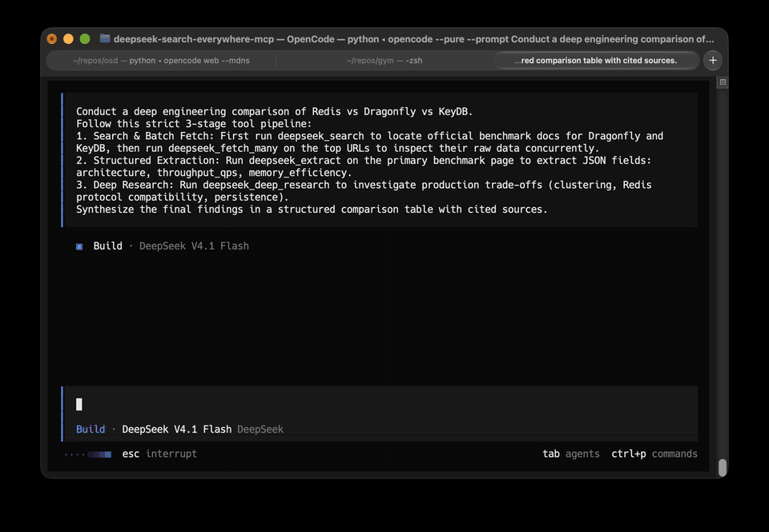

<p align="center">
  
</p>

# DeepSeek Search Everywhere MCP

<p align="center">
  <a href="https://pypi.org/project/deepseek-search-everywhere-mcp/"></a>
  <a href="https://pypistats.org/packages/deepseek-search-everywhere-mcp"></a>
  <a href="https://pypi.org/project/deepseek-search-everywhere-mcp/"></a>
  <a href="https://registry.modelcontextprotocol.io"></a>
  <a href="https://github.com/radoxtech/deepseek-search-everywhere-mcp/actions/workflows/ci.yml"></a>
  <a href="LICENSE"></a>
  <a href="https://glama.ai/mcp/servers/radoxtech/deepseek-search-everywhere-mcp"></a>
</p>

**DeepSeek Search Everywhere** is a [Model Context Protocol (MCP)](https://modelcontextprotocol.io) server that gives AI agents web search, page fetch (web scraping to clean Markdown), structured data extraction and deep research with numbered citations, all through the DeepSeek Search & Fetch API. It runs over stdio or authenticated HTTP and works with Claude Code, Claude Desktop, Cursor, Cline, Windsurf, Zed, OpenCode and any other MCP client.

You need one credential, a DeepSeek API key, and you pay DeepSeek directly per request: there is no separate subscription. It is an alternative to Tavily, Perplexity, Firecrawl and Exa for agents that need live web access, and about 10x cheaper than Tavily for basic search; see [Comparison](#comparison-with-tavily) for the numbers.

<!-- mcp-name: io.github.radoxtech/deepseek-search-everywhere-mcp -->

> Not affiliated with DeepSeek. This is an independent, community-maintained project.

## Demo

<p align="center">
  
</p>
<p align="center">
  <em>OpenCode calling <code>deepseek_search</code>, <code>deepseek_fetch_many</code>, <code>deepseek_extract</code> and <code>deepseek_research</code>. The same tools work in every MCP client.</em>
</p>

## Key features

- **Web search** with snippets or full page text, domain and date filters, language selection and optional query rewrite.
- **Page fetch to Markdown** for one URL or up to 10 in parallel, with section, snippet, offset and find-text selectors for long pages.
- **Structured extraction**: pull named fields or a JSON schema from a page; each value must be backed by a verbatim quote from the page or it is returned as `null`.
- **Deep research with citations**: four depth tiers (`low`, `medium`, `high`, `max`) produce a report with `[n]` citations that map to a `sources` array. Long runs continue in the background and are collected with `deepseek_check_research`.
- **Cost reporting**: every response carries `cost_usd` and, where an LLM is involved, `cost_breakdown`; an optional daily budget blocks overspending.
- **Hardened against prompt injection**: hidden Unicode stripped, markdown images and unsafe links neutralized, an egress guard for secret-like data, static SSRF filtering and no telemetry. See [Security](#security).
- **Small footprint**: pure Python, no local browser, `uvx` zero-install, 9 tools.

## Tools

| Tool | What it does | Key parameters |
|---|---|---|
| `deepseek_search` | Search the web for one query; returns ranked results with snippets, or full page text | `query`, `count` (1-50, default 5), `content` (`snippets` or `full`), `lang`, `include_domains`, `exclude_domains`, `after`, `before`, `exclude_terms`, `exact_phrases`, `rewrite`, `max_total_chars`, `refresh` |
| `deepseek_search_many` | Run 1-5 searches concurrently; partial results are returned if the deadline hits | `queries`, plus the filters of `deepseek_search`, `deadline` |
| `deepseek_fetch` | Fetch one known URL as Markdown | `url`, `max_chars` (default 20000), one optional selector: `section`, `query` (+`max_snippets`), `offset`+`limit`, or `find_text`; `strip_boilerplate`, `fallback_to_search`, `refresh` |
| `deepseek_fetch_many` | Fetch 1-10 URLs concurrently (up to 5 at a time) | `urls`, `max_chars_per_url` (default 4000), `max_total_chars` (default 20000), `query`, `deadline` |
| `deepseek_extract` | Extract structured JSON from one page, with evidence quotes | `url`, `fields` or `schema`, `instruction`, `max_chars` (default 40000) |
| `deepseek_extract_many` | Extract structured JSON from 1-10 pages concurrently | `urls`, `fields` or `schema`, `instruction`, `max_chars_per_url`, `max_total_chars`, `deadline` |
| `deepseek_research` | Multi-angle research: decomposes the topic, searches, reads sources and writes a cited report | `topic` (max 500 chars), `depth` (`low`, `medium`, `high`, `max`; default `medium`), `lang`, `refresh` |
| `deepseek_check_research` | Collect a research job that did not finish inside the inline wait | `job_id` |
| `deepseek_check_balance` | Read-only: DeepSeek account balance and session metrics | none |

Details that matter when calling the tools:

- `query` and each entry of `queries` are limited to 128 characters and accept `site:`, `-site:`, `"phrase"`, `lang:`, `after:` and `before:` operators. The explicit filter parameters (`include_domains`, `exclude_domains`, `exclude_terms`, `exact_phrases`, `after`, `before`) are compiled into operators and budget-checked against that limit together with the query. Dates use `YYYY-MM-DD`.
- `content="snippets"` (default) returns a short snippet per result; `content="full"` returns page text and fetches pages whose search content is missing, which is reflected in `requests_used` and `cost_usd`.
- `deepseek_fetch` selectors are mutually exclusive: combining `section`, `query`, `offset`/`limit` and `find_text` returns `bad_request`. `query` returns focused excerpts around matching terms (lexical matching, no LLM call). `offset`/`limit` page through long text and report `total_chars`.
- `deepseek_fetch_many` skips blanks, fetches duplicate URLs once, keeps input order and reports a failing URL as an item with `ok: false`; the top-level envelope sets `partial: true`.
- `deepseek_extract` takes either `fields` (list of names) or `schema` (JSON schema), never both. Fields whose evidence quote cannot be found in the page are set to `null` with a note; `extraction_truncated` is raised when the model output was cut off.
- `lang` is an ISO code such as `en`, `de`, `pt-BR`. `rewrite=true` translates the query to English with `deepseek-flash` before searching and is skipped when `lang` is set.
- `strip_boilerplate=true` removes known site interface text (for example the localized Reddit UI and cookie-consent dialogs at the start of a page) without touching article text or code blocks. Search results always get this treatment.
- `fallback_to_search=true` (fetch tools) retrieves a document through the search index when a direct fetch returns 404 for a PDF or Reddit URL; only a result for the same page is accepted, and the result is marked `"source": "search_index"`.

Example calls:

```text
deepseek_search(query="rust async runtime comparison", count=5)
deepseek_search(query="gobierno de España presupuestos 2026", lang="es")
deepseek_search(query="tokio runtime", include_domains=["docs.rs"], content="full")
deepseek_fetch(url="https://docs.rs/tokio/latest/tokio/", max_chars=15000)
deepseek_fetch(url="https://example.com/long-article", query="rate limits")
deepseek_fetch_many(urls=["https://example.com/a", "https://example.com/b"])
deepseek_extract(url="https://news.ycombinator.com", fields=["top_story", "points", "author"])
deepseek_research(topic="Raft vs Paxos consensus: trade-offs in practice", depth="high")
deepseek_check_research(job_id="<job_id from a running response>")
deepseek_check_balance()
```

## Quick start

1. Create a DeepSeek API key at [platform.deepseek.com](https://platform.deepseek.com) and add a small balance.
2. Install [uv](https://docs.astral.sh/uv/) (or use `pip`; Python 3.11 or newer is required).
3. Add the server to your MCP client. The minimal configuration is:

```json
{
  "mcpServers": {
    "deepseek-search-everywhere": {
      "command": "uvx",
      "args": ["deepseek-search-everywhere-mcp"],
      "env": { "DEEPSEEK_API_KEY": "sk-..." }
    }
  }
}
```

4. Optional: verify the key and connectivity from a terminal. This prints your balance and exits:

```bash
export DEEPSEEK_API_KEY=sk-...
uvx deepseek-search-everywhere-mcp --check
```

The package is on [PyPI](https://pypi.org/project/deepseek-search-everywhere-mcp/) and in the
[official MCP Registry](https://registry.modelcontextprotocol.io/v0/servers?search=deepseek-search-everywhere) as
`io.github.radoxtech/deepseek-search-everywhere-mcp`. The console script is `deepseek-search-everywhere-mcp`;
`python -m deepseek_search_everywhere_mcp` is equivalent.

```bash
pip install deepseek-search-everywhere-mcp              # or: uvx deepseek-search-everywhere-mcp
pip install "deepseek-search-everywhere-mcp[http]"      # adds uvicorn for the HTTP transport
uvx --from git+https://github.com/radoxtech/deepseek-search-everywhere-mcp deepseek-search-everywhere-mcp  # latest main
```

## Install in your MCP client

All stdio examples use `uvx`, so nothing is installed globally. Replace `sk-...` with your key.

### Claude Code

```bash
claude mcp add deepseek-search-everywhere -e DEEPSEEK_API_KEY=sk-... -- \
  uvx deepseek-search-everywhere-mcp
```

### Claude Desktop

Edit `claude_desktop_config.json` (Settings, Developer, Edit Config):

```json
{
  "mcpServers": {
    "deepseek-search-everywhere": {
      "command": "uvx",
      "args": ["deepseek-search-everywhere-mcp"],
      "env": { "DEEPSEEK_API_KEY": "sk-..." }
    }
  }
}
```

### Cursor

Create or edit `.cursor/mcp.json` in your project (or `~/.cursor/mcp.json` for all projects):

```json
{
  "mcpServers": {
    "deepseek-search-everywhere": {
      "command": "uvx",
      "args": ["deepseek-search-everywhere-mcp"],
      "env": { "DEEPSEEK_API_KEY": "sk-..." }
    }
  }
}
```

### Cline and Roo Code (VS Code)

In the MCP settings file (`cline_mcp_settings.json`):

```json
{
  "mcpServers": {
    "deepseek-search-everywhere": {
      "command": "uvx",
      "args": ["deepseek-search-everywhere-mcp"],
      "env": { "DEEPSEEK_API_KEY": "sk-..." },
      "disabled": false,
      "autoApprove": []
    }
  }
}
```

### Windsurf

In `~/.codeium/windsurf/mcp_config.json`:

```json
{
  "mcpServers": {
    "deepseek-search-everywhere": {
      "command": "uvx",
      "args": ["deepseek-search-everywhere-mcp"],
      "env": { "DEEPSEEK_API_KEY": "sk-..." }
    }
  }
}
```

### Zed

In Zed `settings.json`, under `context_servers`:

```json
{
  "context_servers": {
    "deepseek-search-everywhere": {
      "source": "custom",
      "command": "uvx",
      "args": ["deepseek-search-everywhere-mcp"],
      "env": { "DEEPSEEK_API_KEY": "sk-..." }
    }
  }
}
```

### OpenCode

In `opencode.json`:

```json
{
  "$schema": "https://opencode.ai/config.json",
  "mcp": {
    "deepseek-search-everywhere": {
      "type": "local",
      "command": ["uvx", "deepseek-search-everywhere-mcp"],
      "environment": { "DEEPSEEK_API_KEY": "{env:DEEPSEEK_API_KEY}" },
      "enabled": true
    }
  }
}
```

### Any other stdio client (Antigravity, Gemini CLI and others)

Any client that accepts an `mcpServers` block works with the `uvx` form above. With the package installed locally, point at the console script:

```json
{
  "mcpServers": {
    "deepseek-search-everywhere": {
      "command": "deepseek-search-everywhere-mcp",
      "env": { "DEEPSEEK_API_KEY": "sk-..." }
    }
  }
}
```

### Streamable HTTP

For clients and platforms that connect over HTTP. A bearer token is always required and the server refuses to start without `MCP_BEARER_TOKEN`.

```bash
pip install "deepseek-search-everywhere-mcp[http]"
export DEEPSEEK_API_KEY=sk-...
export MCP_BEARER_TOKEN="$(python -c 'import secrets; print(secrets.token_urlsafe(32))')"
deepseek-search-everywhere-mcp --transport streamable-http   # http://127.0.0.1:8000/mcp
```

Options: `--host` (default `127.0.0.1`), `--port` (default `8000`), `--path` (default `/mcp`). The token is read from the environment only, never from the command line. The server is stateless and answers with JSON (no SSE streams). Client entry:

```json
{
  "mcpServers": {
    "deepseek-search-everywhere": {
      "url": "http://127.0.0.1:8000/mcp",
      "headers": { "Authorization": "Bearer <MCP_BEARER_TOKEN>" }
    }
  }
}
```

Claude Code over HTTP:

```bash
claude mcp add --transport http deepseek-search-everywhere http://127.0.0.1:8000/mcp \
  --header "Authorization: Bearer $MCP_BEARER_TOKEN"
```

The server speaks plain HTTP; when binding beyond loopback, put TLS in front of it (see [SECURITY.md](SECURITY.md)). HTTP mode is single-process: research jobs, caches and the rate limiter live in that process.

### Docker

A container image is published on GitHub Container Registry. It runs as an unprivileged user (UID 10001).

```bash
docker pull ghcr.io/radoxtech/deepseek-search-everywhere-mcp:latest
```

Stdio mode for desktop clients:

```json
{
  "mcpServers": {
    "deepseek-search-everywhere": {
      "command": "docker",
      "args": [
        "run", "-i", "--rm",
        "-e", "DEEPSEEK_API_KEY=sk-...",
        "ghcr.io/radoxtech/deepseek-search-everywhere-mcp:latest"
      ]
    }
  }
}
```

Remote HTTP hosting:

```bash
docker run -d --name deepseek-mcp -p 8000:8000 \
  -e DEEPSEEK_API_KEY="sk-..." \
  -e MCP_BEARER_TOKEN="your-secret-token" \
  ghcr.io/radoxtech/deepseek-search-everywhere-mcp:latest \
  --transport streamable-http --host 0.0.0.0 --port 8000
```

## Deep research

`deepseek_research(topic, depth=...)` turns a question into a cited report. It decomposes the topic into subqueries, searches them concurrently, ranks and de-duplicates sources (at most 2 per registered domain, with hosts from the source denylist skipped), reads the top pages, and has `deepseek-flash` write a report whose `[n]` citations match the ids in the returned `sources` array. Synthesis runs on the server, so the consuming agent receives a short report and a list of sources instead of tens of thousands of characters of page text.

### Depth tiers

| | `low` | `medium` (default) | `high` | `max` |
|---|---|---|---|---|
| Subqueries | 2 | 3 | 4 | 4, plus a gap-analysis round |
| Results per subquery | 6 | 8 | 10 | 10 |
| Sources read (K) | 6 | 10 | 16 | 24 |
| Characters per source page (cap) | 15,000 | 20,000 | 25,000 | 30,000 |
| Total source context | 60,000 chars | 150,000 chars | 300,000 chars | 500,000 chars |
| Reasoning in synthesis | off | on, effort `low` | on, effort `high` | on, effort `max` |
| Synthesis `max_tokens` | 16,384 | 32,768 | 65,536 | 131,072 |
| Report length target | about 400 words | about 800 | about 1,200 | about 1,800 |
| Report length ceiling (+20%) | 480 | 960 | 1,440 | 2,160 |
| Total deadline | 60 s | 90 s | 150 s | 240 s |

When to pick each tier:

- **`low`**: a quick factual overview or a sanity check with a handful of sources; fastest and cheapest.
- **`medium`**: the default for most questions: comparisons, "how does X work", state of a technology.
- **`high`**: decisions that depend on several viewpoints, such as architecture choices, vendor evaluations or regulatory questions.
- **`max`**: broad or contested topics where coverage matters more than speed; the extra round looks for gaps in the first round and searches again.

If the model's reasoning uses up its token allowance or returns an empty answer, the server retries once with reasoning off; if that also fails, the envelope has `synthesized: false` and returns source snippets only. An over-length report gets one cheap condensing pass.

### Long-running research

Many MCP clients cancel a tool call after about 60 seconds, which is shorter than the `high` and `max` deadlines. `deepseek_research` therefore never blocks past an inline wait of 45 seconds:

1. The research runs as a background job inside the server process, not inside the tool call. A client timeout or a cancelled call does not stop the job.
2. If the report is ready within 45 s, `deepseek_research` returns it inline with `status: "done"` and `delivery: "inline"`.
3. Otherwise it returns `ok: true`, `status: "running"`, a `job_id`, `elapsed_ms`, a `progress` object (`phase`, `step`, `of`) and a `next_action` telling the agent to call `deepseek_check_research` with that `job_id` and not to start a new research.
4. `deepseek_check_research(job_id)` waits up to another 45 s and returns either the same final envelope (`status: "done"`, `delivery: "polled"`) or `status: "running"` again. Repeat until it is done. An unknown or expired id returns `job_not_found`; start the research again in that case (the job may have been lost on a server restart).

Behavior to know:

- An identical request (same topic, depth and language) made while a job is running joins that job and gets the same `job_id`, so a retry never doubles the cost.
- A finished result is reused for 30 minutes at zero cost (`cached: true`, `cost_usd: 0`); pass `refresh=true` to run again.
- At most 3 research jobs run at the same time; further requests return `rate_limited_local`.
- Jobs live in memory in one server process. They are cancelled when the server shuts down.

## Costs

Search and Fetch are billed by DeepSeek per successful request, not per returned result, so `count` does not change the price of a call. Extraction and research add `deepseek-flash` token costs on top of the requests they make. Cache hits cost nothing.

| Item | Price |
|---|---|
| Search and Fetch API | $0.75 per 1,000 successful requests ($0.00075 each) |
| `deepseek-flash` input, cache hit | $0.003 per 1M tokens |
| `deepseek-flash` input, cache miss | $0.15 per 1M tokens |
| `deepseek-flash` output | $0.60 per 1M tokens |

*Prices shown are DeepSeek off-peak rates as of 2026-11-12; see https://api-docs.deepseek.com/quick_start/pricing.*

Measured cost and wall time of one `deepseek_research` call per tier (live runs):

| Depth | Typical cost | Typical time |
|---|---|---|
| `low` | about $0.003 | about 6 s |
| `medium` | about $0.008 | about 18-29 s |
| `high` | about $0.012 | about 39 s |
| `max` | about $0.024-0.031 | about 50-110 s |

*Prices shown are DeepSeek off-peak rates as of 2026-11-12; see https://api-docs.deepseek.com/quick_start/pricing.*

Other tools: `deepseek_search` and `deepseek_fetch` cost one request each ($0.00075); `content="full"` and `deepseek_fetch_many` add one request per page fetched; `deepseek_extract` costs about $0.002 per page (one fetch plus the LLM call). `rewrite=true` on the search tools adds one small `deepseek-flash` call.

*Prices shown are DeepSeek off-peak rates as of 2026-11-12; see https://api-docs.deepseek.com/quick_start/pricing.*

Every response reports its own `cost_usd`, and tools that call an LLM add `cost_breakdown` with `search`, `fetch` and `llm` parts. Set `DEEPSEEK_DAILY_BUDGET_USD` to cap daily spend (see [Configuration](#configuration)).

## Comparison with Tavily

Figures as of 2026-11-12. Tavily pay-as-you-go is $0.008 per credit; a basic search costs 1 credit, an advanced search 2 credits, and a basic extract 1 credit per 5 URLs ([Tavily API credits](https://docs.tavily.com/documentation/api-credits)). Tavily also has a free tier of 1,000 credits per month, which covers light use at no cost.

| Operation | Tavily (pay-as-you-go) | This server (Search and Fetch API) | Ratio |
|---|---|---|---|
| Basic search | $0.008 | $0.00075 | about 10.7x cheaper |
| Advanced search | $0.016 | $0.00075 | about 21x cheaper |
| Page fetch, per URL (basic extract) | $0.0016 | $0.00075 | about 2.1x cheaper |

*Prices shown are DeepSeek off-peak rates as of 2026-11-12; see https://api-docs.deepseek.com/quick_start/pricing.*

The comparison covers raw retrieval prices only. It does not compare result quality, and structured extraction and research in this server add `deepseek-flash` token costs shown in [Costs](#costs). Tavily, Perplexity, Firecrawl and Exa each have features this server does not (for example site crawling or hosted answer engines); this server covers search, fetch, extraction and research in a single MCP server.

## Security

Web pages, search snippets and titles are attacker-controlled. The server treats everything it retrieves as untrusted and applies these controls (full threat model in [SECURITY.md](SECURITY.md)):

- **Untrusted-content handling.** Hidden Unicode (tag characters, bidi controls, zero-width characters) is stripped from content, snippets, titles, reports and extracted values. Markdown images are rewritten to plain `[image: alt](url)` text and links with non-http(s) targets are dropped. Every response that carries web data sets `untrusted_content: true`; research and extraction output, which is model-written from untrusted pages, also sets `derived_from_untrusted: true`.
- **Injection-resistant synthesis.** The server's own LLM calls have no tool calling and no secrets in their prompts. Sources are wrapped in per-call random delimiters and declared to be data, and the report is filtered afterwards: links that are not in the source list, images, raw HTML and sentences addressed to an AI agent are removed (counted in `injection_suspected`).
- **Egress guard.** Outgoing search queries and fetch URLs that contain secret-like data (`sk-` keys, bearer tokens, JWTs, AWS access keys, `api_key=`/`token=`/`password=` pairs, URL credentials) are rejected with `egress_blocked`. Optional domain allow and deny lists and a high-entropy check are available through [environment variables](#configuration).
- **Static SSRF filter.** Non-http(s) URLs return `bad_url`; internal hostnames, private and loopback addresses and URLs with embedded credentials return `ssrf_blocked`. The server never resolves DNS locally; DeepSeek performs the fetch, so this is a filter and not network isolation.
- **No telemetry.** The server does not phone home or collect usage data.
- **Data flow.** Search queries, URLs you ask it to fetch, and page content selected for extraction or research are sent to the DeepSeek API; nothing else leaves the machine, and the API key is only sent in the `Authorization` header to the configured base URL. Do not put secrets in queries or URLs.
- **HTTP transport.** Every request needs the bearer token (constant-time comparison, never logged). Bind to loopback or put TLS in front of the server.

The consuming agent must still treat returned content as untrusted: no filter can guarantee that a page contains no instructions. Report vulnerabilities privately as described in [SECURITY.md](SECURITY.md).

## Configuration

The server reads configuration from environment variables. It does not read `.env` files itself; export the variables or set them in your MCP client's `env` block.

**Required**

| Variable | Purpose |
|---|---|
| `DEEPSEEK_API_KEY` | Your DeepSeek platform key |
| `MCP_BEARER_TOKEN` | HTTP transport only: token clients send as `Authorization: Bearer ...`; the server refuses to start HTTP without it |

**Optional**

| Variable | Default | Purpose |
|---|---|---|
| `DEEPSEEK_BASE_URL` | `https://api.deepseek.com` | API base URL |
| `DEEPSEEK_MCP_CACHE` | `1` | `0` disables the in-memory response caches |
| `DEEPSEEK_MCP_LOG_LEVEL` | `WARNING` | Log level: `DEBUG`, `INFO`, `WARNING`, `ERROR`, `CRITICAL` |
| `DEEPSEEK_DAILY_BUDGET_USD` | unlimited | Daily spend cap in USD, e.g. `5.00` |
| `DEEPSEEK_STATE_DIR` | see below | Directory of the budget state file |
| `DEEPSEEK_SOURCE_DENYLIST` | unset | Hosts research never uses as sources (library-proxy hosts are rewritten to the publisher); `none` disables |
| `DEEPSEEK_FETCH_ALLOW_DOMAINS` | unset | Fetch only these domains |
| `DEEPSEEK_FETCH_DENY_DOMAINS` | unset | Never fetch these domains |
| `DEEPSEEK_EGRESS_ENTROPY_CHECK` | off | `1` also blocks long high-entropy tokens |
| `DEEPSEEK_AUTH_JSON` | see below | Legacy key file, used only without `DEEPSEEK_API_KEY` |

Details:

- **Daily budget** covers Search, Fetch and LLM costs and resets per UTC day; once reached, calls fail with `budget_exceeded`. The state lives in `budget.json` under `DEEPSEEK_STATE_DIR` (default `~/.cache/deepseek-search-everywhere-mcp`).
- **Domain lists** (`DEEPSEEK_SOURCE_DENYLIST`, `DEEPSEEK_FETCH_ALLOW_DOMAINS`, `DEEPSEEK_FETCH_DENY_DOMAINS`) are comma-separated; an entry matches the host and its subdomains, and an entry containing `*` is a glob matched against the whole host.
- **Entropy check** (`1`, `true` or `yes`) rejects queries and URL paths that contain a token longer than 32 characters with high entropy.
- **Legacy key file**: `DEEPSEEK_AUTH_JSON` points to an opencode credentials file (`{"deepseek": {"key": "..."}}`); without it the server tries `~/.local/share/opencode/auth.json`.

Command-line options of `deepseek-search-everywhere-mcp`: `--transport {stdio,streamable-http}` (default `stdio`), `--host` (default `127.0.0.1`), `--port` (default `8000`), `--path` (default `/mcp`), `--check` (verify credentials and print the balance; stdio only) and `--version`.

Local limits that are not configurable through the environment:

| | Search | Fetch | Query rewrite |
|---|---|---|---|
| Cache TTL | 5 min | 30 min | 24 h |
| Entry limit | 128 | 128 | 1024 |
| Rate limit (sustained / burst) | 10 / s, 20 | 5 / s, 10 | LLM calls: 10 / s, 20 |

Only successful, non-empty responses are cached and errors are never cached. Identical concurrent calls share one upstream request. `refresh=true` bypasses the cache for one call. If a rate-limit token would take longer than 5 s, the call fails with `rate_limited_local`. HTTP 429 and gateway 5xx responses are retried once within the call's deadline.

## Response format

Every tool returns a JSON object with `ok`.

| Field | Where | Meaning |
|---|---|---|
| `ok` | all | `true` on success, `false` on failure |
| `error` | failures | `{ "code", "message", "status"?, "upstream_code"?, "upstream_message"? }`; `code` is always one of the [closed error codes](#error-codes) |
| `elapsed_ms` | all | wall time of the call in milliseconds |
| `cost_usd` | retrieval tools | cost of the call in USD; `0` for cache hits |
| `cost_breakdown` | extract, research | `{ "search", "fetch", "llm" }` in USD |
| `requests_used` | search, fetch_many, research | upstream requests actually made |
| `cached`, `cached_count` | retrieval tools | whether the response (or how many items) came from the cache |
| `notes` | success envelopes | human-readable remarks: dedupe counts, trimmed queries, truncation, applied filters |
| `partial`, `failed_count` | batch tools, research | `true` when some items or sources failed; each failed one carries its own `error`. The top-level `ok` stays `true`, so check `partial` |
| `untrusted_content` | tools returning web content | always `true`; the content is data, not instructions |
| `derived_from_untrusted`, `injection_suspected` | research | model-written output built from untrusted pages; number of sentences removed by the output filter |
| `status`, `delivery`, `job_id`, `progress`, `next_action` | research, check_research | job state: `done` (with `delivery` `inline` or `polled`) or `running` |
| `_meta` | retrieval tools | `{ "cost_usd", "untrusted_content" }` for clients that read MCP metadata |

Tool-specific results:

- **Search**: `results[]` with `title`, `url`, `date`, `date_source` (`upstream`, `content` or `null`), `site`, `snippet` (and `content` with `content="full"`), `authority` and `rerank_score` (upstream fields, not credibility scores).
- **Fetch**: `url`, `title`, `content`, `chars`, `total_chars`, `truncated`, `source` (`fetch` or `search_index`); selectors add `has_more` or section metadata.
- **Extract**: `data` (requested fields or schema), `evidence` (verbatim quotes), `extraction_truncated`.
- **Research**: `topic`, `depth`, `subqueries`, `report` (with `[n]` citations), `synthesized`, `sources[]` of `{ id, title, url, date }` where `id` equals `n`. There is no references list inside the report and no page content in the envelope.
- **Balance**: `is_available`, `balances`, and a `session` block with uptime, request and cache counts.

### Error codes

`error.code` comes from a closed set. Upstream DeepSeek errors are mapped to it and the original code and message (redacted) are kept in `error.upstream_code` and `error.upstream_message`.

| Group | Codes |
|---|---|
| Upstream, mapped | `auth_failed`, `insufficient_balance`, `upstream_rate_limited`, `upstream_timeout`, `upstream_error`, `not_found`, `blocked_by_site` |
| Local and transport | `missing_api_key`, `rate_limited_local`, `timeout`, `deadline_exceeded`, `response_too_large`, `invalid_json`, `network_error`, `request_failed`, `internal_error` |
| Budget | `budget_exceeded` (status 402) |
| Input validation | `bad_request`, `empty_query`, `query_too_long`, `topic_too_long`, `bad_count`, `bad_lang`, `bad_url`, `empty_url`, `url_too_long`, `bad_domain`, `bad_date`, `bad_term`, `bad_phrase`, `filters_too_long` |
| Security | `ssrf_blocked`, `egress_blocked`, `disallowed_url`, `private_url`, `disallowed_protocol` |
| Tool specific | `empty_page`, `extraction_failed`, `extraction_truncated`, `job_not_found` |

## Migration from 2.x

Version 3.0 is a breaking release: tool names, parameters, envelope fields and error codes changed. Tool surface and parameters are summarized below; update your prompts, allow-lists and any code that parses envelopes.

### Tools

| 2.x | 3.0 | Notes |
|---|---|---|
| `deepseek_deep_research` | `deepseek_research` | Parameters `max_queries` and `max_pages_per_query` are replaced by `depth` (`low`, `medium`, `high`, `max`) |
| `deepseek_research` (single-pass source gathering) | `deepseek_search` with `content="full"`, or `deepseek_search_many` | The old tool returned raw sources without a model call; research now means the cited report |
| `deepseek_web_search` (alias) | `deepseek_search` | Alias removed |
| `deepseek_search_and_read` (alias) | `deepseek_search` with `content="full"` | Alias removed |
| `deepseek_balance` (alias) | `deepseek_check_balance` | Alias removed |
| none | `deepseek_check_research` | New: collects long-running research jobs |

### Parameters

| 2.x | 3.0 |
|---|---|
| `need_content=True` / `False` (search tools) | `content="full"` / `"snippets"` |
| `ori_question` | removed |
| `localization` | removed |
| `max_chars_per_result`, `summary_chars` | removed; the per-result budget is derived from `max_total_chars` and `count`, snippets are capped at 400 characters |
| `dedupe`, `strip_boilerplate` (search tools) | removed; always on |
| `clear_cache` (`deepseek_check_balance`) | removed; the tool is read-only |
| `question`, `max_pages`, `per_page_chars`, `total_chars` (old `deepseek_research`) | `topic` and `depth` of the new `deepseek_research` |
| `max_queries`, `max_pages_per_query` (`deepseek_deep_research`) | `depth` |
| Positional optional arguments | all parameters after the first are keyword-only |
| Combining fetch selectors | `section`, `query`, `offset`/`limit` and `find_text` are mutually exclusive; combining them returns `bad_request` |
| none | `fallback_to_search` on the fetch tools (default `true`) |

### Envelope fields

| 2.x | 3.0 |
|---|---|
| `need_content` field in search envelopes | `content` |
| `summary` next to a non-empty `snippet` in snippet mode | omitted; `summary` appears only for results without a snippet |
| `raw_sources` and page content inside research `sources` | removed; `sources` holds `id`, `title`, `url`, `date` (plus a short snippet if synthesis fell back) |
| `## References` section appended to the research report | removed; use the `sources` array (ids match the `[n]` citations) |
| `cache_cleared`, `cache_evicted` (balance) | removed |
| none | `status`, `delivery`, `job_id`, `progress`, `next_action` (research), `cost_breakdown`, `derived_from_untrusted`, `injection_suspected`, `evidence` and `extraction_truncated` (extract), `depth` |

### Error code changes

| 2.x | 3.0 |
|---|---|
| `http_404` | `not_found` |
| `http_429` | `upstream_rate_limited` |
| `http_error` and other raw upstream codes | `upstream_error` (5xx) or `bad_request` (other 4xx); the original is in `error.upstream_code` |
| HTTP 401 from any endpoint | `auth_failed` |
| HTTP 403 from the fetch endpoint | `blocked_by_site` |
| HTTP 403 from other endpoints | `auth_failed` |
| HTTP 402 | `insufficient_balance` |
| HTTP 504 | `upstream_timeout` |
| `invalid_url` | `bad_url` |
| `budget_exceeded` with status 429 | `budget_exceeded` with status 402 |
| none | `egress_blocked`, `extraction_truncated`, `job_not_found` |

Behavior changes: extracted values without a verifiable evidence quote are returned as `null`; fetch no longer substitutes a different page when a URL returns 404 (only a result for the same page is accepted); research and extraction output is sanitized and flagged as derived from untrusted content.

## FAQ

### How do I add web search to Claude Code?

Run `claude mcp add deepseek-search-everywhere -e DEEPSEEK_API_KEY=sk-... -- uvx deepseek-search-everywhere-mcp`. Claude Code then has `deepseek_search`, `deepseek_fetch`, `deepseek_extract`, `deepseek_research` and the other tools of this server. You need a DeepSeek API key and `uv` installed; see [Quick start](#quick-start).

### Is there a cheaper alternative to Tavily for MCP?

For retrieval, yes: this server passes through DeepSeek's Search and Fetch price of $0.75 per 1,000 successful requests, against Tavily's $0.008 per basic search credit, which is about 10.7x cheaper for basic search and about 21x for advanced search as of 2026-11-12. Tavily's free tier of 1,000 credits per month may still be enough for light use. See [Comparison](#comparison-with-tavily) for the sources and caveats.

*Prices shown are DeepSeek off-peak rates as of 2026-11-12; see https://api-docs.deepseek.com/quick_start/pricing.*

### How does deepseek_research handle long-running research?

It runs the research as a background job and returns the finished report inline if it is ready within 45 seconds. Otherwise it returns `status: "running"` with a `job_id` and a `next_action`, and the agent calls `deepseek_check_research(job_id)` until the status is `done`. The job survives client timeouts and cancelled calls, identical requests join the running job, and finished results are reused for 30 minutes at zero cost. See [Long-running research](#long-running-research).

### Does it work with Cursor, Cline and Windsurf?

Yes. It is a standard MCP server using stdio (or authenticated streamable HTTP), so any client that can launch a command or connect to a URL can use it. Ready-made configuration for Cursor, Cline and Roo Code, Windsurf, Zed, OpenCode, Claude Desktop and Claude Code is in [Install in your MCP client](#install-in-your-mcp-client).

### How much does a search cost?

A search or a page fetch costs one DeepSeek request, $0.00075, regardless of how many results are returned. A research call costs roughly $0.003 (`low`) to $0.03 (`max`) including model tokens, and a structured extraction about $0.002 per page. Every response reports `cost_usd` so the agent and you can see the actual cost.

*Prices shown are DeepSeek off-peak rates as of 2026-11-12; see https://api-docs.deepseek.com/quick_start/pricing.*

### Can it read PDFs and JavaScript-rendered pages?

Pages are fetched by DeepSeek's service, not by a local browser, and the result is returned as Markdown. Whether a given PDF or script-heavy page yields text depends on that service. When a direct fetch of a PDF or Reddit URL returns 404, the server retrieves the document through the search index instead; when a page comes back empty, the response says so and suggests `deepseek_search`.

### Can I extract structured data from a web page?

Yes. `deepseek_extract` takes a URL and either a list of `fields` or a JSON `schema` and returns `data` plus an `evidence` quote for each value. A value whose quote cannot be found in the page is returned as `null`, so invented values do not pass silently. `deepseek_extract_many` does the same for up to 10 URLs at once.

### Is my data sent anywhere?

Search queries, the URLs you fetch and the page content used for extraction or research go to the DeepSeek API, which performs the work; there is no other outbound destination and no telemetry. Queries and URLs that contain secret-like strings are blocked before they leave the machine. Details are in [Security](#security) and [SECURITY.md](SECURITY.md).

### How do I limit spending?

Set `DEEPSEEK_DAILY_BUDGET_USD` (for example `5.00`) in the server's environment. Once the day's spend reaches the limit, calls return `budget_exceeded` until the next UTC day. Use `depth="low"` for research when speed and cost matter, and check `deepseek_check_balance` for the account balance.

### Can the server run remotely, for example in Docker or n8n?

Yes. Start it with `--transport streamable-http` and set `MCP_BEARER_TOKEN`; the official image `ghcr.io/radoxtech/deepseek-search-everywhere-mcp` supports this. The HTTP transport is stateless, single-process and plain HTTP, so put TLS in front of it when exposing it beyond loopback.

### Is this an official DeepSeek project?

No. It is an independent, community-maintained MCP server that calls the public DeepSeek Search & Fetch API and the `deepseek-flash` chat model with your own API key.

## Limitations

- Fetch latency is DeepSeek's page render: an already rendered page returns in about 0.5 s, others take 3-10 s, and a missing page still takes 3-5 s before DeepSeek reports it.
- Direct fetch does not render raw binary files such as PDFs natively; see the PDF fallback above.
- Fetch returns title and content only: no final URL, status code or publication date.
- Search and fetch only: no site mapping or crawling, and a single provider (DeepSeek). Native MCP Tasks are not used; long research uses `deepseek_check_research`.
- The cache, rate limiter and research job store are per process; several server processes multiply the effective rate.
- Local rate limits are conservative defaults and do not replace DeepSeek's own quotas.
- The HTTP transport is plain HTTP, stateless and JSON-only; there is no OAuth and no SSE stream.

## Development

```bash
git clone https://github.com/radoxtech/deepseek-search-everywhere-mcp.git
cd deepseek-search-everywhere-mcp
python -m venv .venv && . .venv/bin/activate
pip install -e ".[test,lint,http]" build twine

pytest -q                       # offline suite; no network and no key needed
ruff check . && ruff format --check .
python -m build && twine check dist/*
python scripts/validate_server_json.py
```

Live tests (`pytest -m live`, plus the `live_llm` and `live_e2e` suites) call the real API with your own key and are opt-in. See [CONTRIBUTING.md](CONTRIBUTING.md) for the workflow and commit conventions and [AGENTS.md](AGENTS.md) for the code layout and project invariants. Releases are automated with [release-please](https://github.com/googleapis/release-please) from [Conventional Commits](https://www.conventionalcommits.org/en/v1.0.0/), and `server.json` is published to the [MCP Registry](https://modelcontextprotocol.io/registry) by the release workflow; the `mcp-name` comment near the top of this file is used by the registry to verify package ownership.

Release notes: [CHANGELOG.md](CHANGELOG.md).

## License

[MIT](LICENSE). Not affiliated with DeepSeek.
