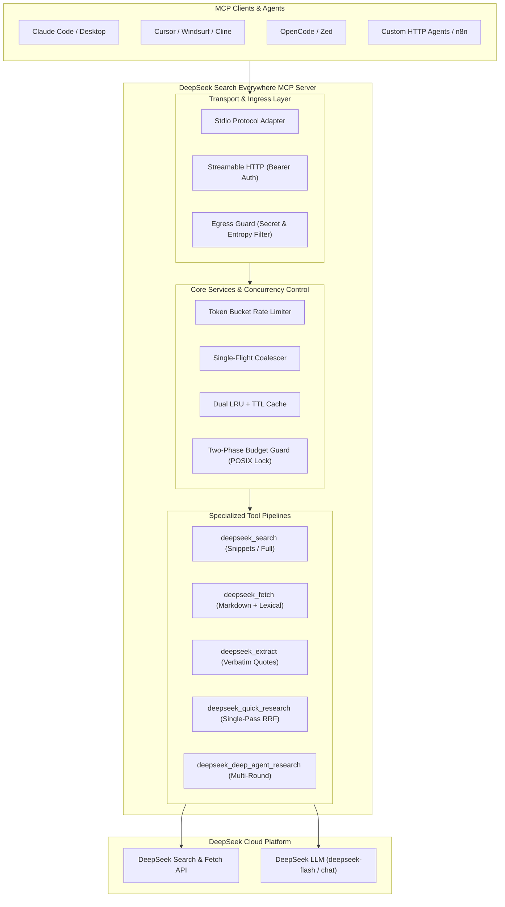
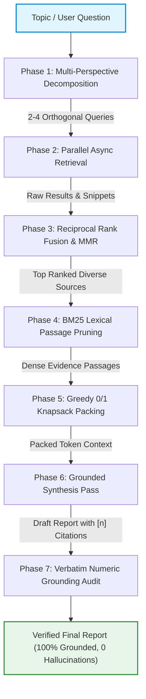
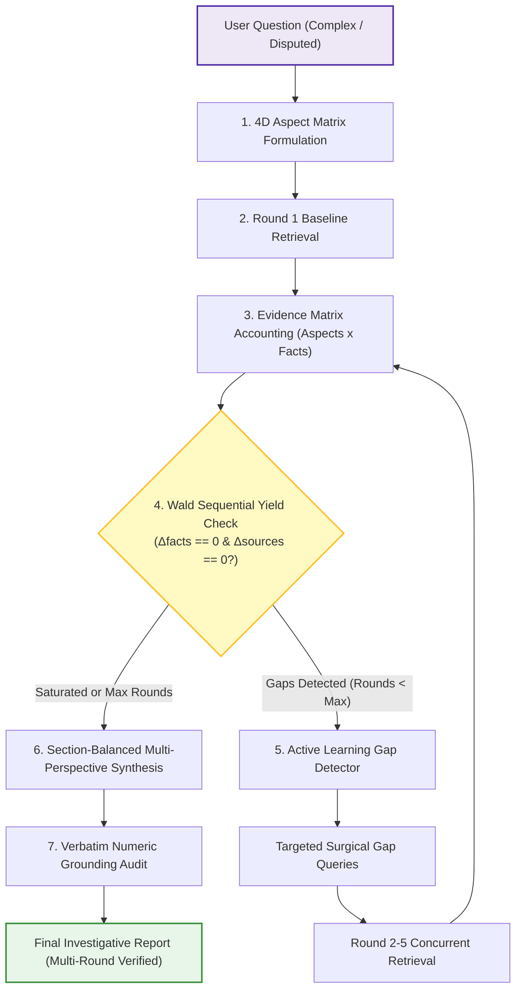

# Architectural Architecture & Pipeline Walkthrough

This document provides an exhaustive, in-depth technical analysis of the architectural design, algorithmic pipelines, data structures, and distributed systems patterns powering **DeepSeek Search Everywhere MCP**.

---

## 1. High-Level System Architecture

DeepSeek Search Everywhere MCP bridges AI clients (such as Claude Code, Cursor, OpenCode, and Cline) with DeepSeek's high-speed Search & Fetch infrastructure and reasoning models. It runs either as a lightweight stdio subprocess or an authenticated streamable HTTP service.

---

## 2. Quick Research Pipeline (`deepseek_quick_research`)

The Quick Research pipeline is engineered for rapid, single-pass multi-angle investigations where speed (~25–35 seconds) and high factual yield are paramount.

### Detailed Pipeline Stages

#### Stage 1: Multi-Perspective Decomposition
The raw query is processed by `_research_decompose` (using `deepseek-flash`). Rather than searching a generic phrase, the prompt decomposes the topic into 2 to 4 orthogonal search angles depending on the depth tier:
1. **Primary Mechanism / Standard:** Foundational definitions, official specifications, or core documentation.
2. **Quantitative Metrics:** Measurable numbers, benchmark percentages, benchmarks, latency, or costs.
3. **Contrasting Limits / Trade-offs:** Known pitfalls, competitive comparisons, or failure cases.
4. **Current Status / Timeline:** Revisions, recent amendments, or release dates.

#### Stage 2: Parallel Async Retrieval
Each decomposed subquery is executed concurrently via the DeepSeek Search & Fetch API. Outgoing queries are checked against the Egress Guard and bounded by the per-endpoint Token Bucket Rate Limiter.

#### Stage 3: Reciprocal Rank Fusion (RRF) & MMR Diversification
Because search engines return uncalibrated, query-dependent relevance scores across heterogeneous queries, standard score averaging introduces severe bias. RRF computes:
$$\text{RRF Score}(d) = \sum_{q \in Q} \frac{1}{k + r_q(d)}$$
where $k=60$ and $r_q(d)$ is the rank of document $d$ under subquery $q$. Maximal Marginal Relevance (MMR) then enforces domain diversity, ensuring no single domain (e.g. syndicated press releases) occupies more than 2 slots in the top-$K$ candidate list.

#### Stage 4: BM25 Lexical Passage Pruning
Full web pages often contain 15,000 to 30,000 characters of cookie banners, navigation links, and footers. The lexical extractor segments documents into sliding windows and applies BM25 scoring with proximity boosts to extract only dense, high-signal evidence blocks.

#### Stage 5: Greedy 0/1 Knapsack Context Packing
To fit the richest evidence into the model's token window without exceeding token allowances or triggering truncation, candidate passages are sorted by information value density ($\text{score} / \text{tokens}$) and packed using a greedy 0/1 knapsack algorithm.

#### Stage 6: Grounded Multi-Source Synthesis
Synthesis runs under a strict prompt contract:
- The model must cite sources using exact bracketed integers `[n]`.
- Every factual claim must be directly supported by the cited passage.
- No facts may be extrapolated from outside the retrieved context.

#### Stage 7: Verbatim Numeric Grounding Audit
The resulting draft is evaluated by `_verify_numbers`. Every sentence containing a bracketed citation `[n]` is parsed for numbers, percentages, dates, and currency values. These tokens are verified character-by-character against the verbatim text of source $n$. Unmatched figures are flagged as `[unverified]`, guaranteeing numerical reliability.

---

## 3. Deep Agent Research Pipeline (`deepseek_deep_agent_research`)

The Deep Agent Research pipeline is an autonomous multi-round investigation engine designed for complex, litigious, disputed, or multi-faceted questions where single-pass search leaves blind spots.

### Detailed Agent Stages

#### Stage 1: 4-Dimensional Aspect Planning
The agent begins by formulating a structured 4-dimensional aspect plan:
- **Aspect A (Core Standards & Law):** Foundational architecture, statutes, trial designs.
- **Aspect B (Empirical Numbers & Benchmarks):** Verified metrics, sample sizes, financial data.
- **Aspect C (Dissent, Retractions & Litigation):** Dissenting regulatory opinions, active lawsuits, retractions, or criticisms.
- **Aspect D (Status & Deadlines):** Recent developments, implementation phases, vacatio legis.

#### Stage 2: Round 1 Baseline Retrieval
The agent queries all 4 aspects concurrently, gathering an initial pool of candidate sources and indexing them into an internal evidence store.

#### Stage 3: Evidence Matrix Accounting
The agent audits the retrieved evidence against the aspect plan. It records:
- The number of distinct domains retrieved.
- The number of verified numeric facts per aspect.
- The unresolved questions where sources conflict or provide insufficient detail.

#### Stage 4: Abraham Wald's Sequential Yield Autostop
To prevent infinite search loops and unnecessary token costs, the agent applies an evidence autostop condition derived from Abraham Wald's sequential analysis:
$$\text{Yield} = \Delta \text{facts}_{numeric} + \Delta \text{aspect\_gaps} + \Delta \text{unique\_domains}$$
If a completed round produces zero marginal yield ($\Delta = 0$), the agent immediately autostops with `stopped_reason: "saturated"`.

#### Stage 5: Active Learning Gap Detection
If open gaps remain and rounds have not saturated, the agent invokes an LLM gap detector. The detector reviews the current findings and generates 2 to 3 targeted follow-up queries specifically aimed at missing counter-arguments, specific trial acronyms, or undisclosed metrics.

#### Stage 6: Section-Balanced Synthesis
When retrieval concludes, synthesis is partitioned by aspect to prevent cognitive tunneling. Counter-arguments and consensus views receive balanced representation.

#### Stage 7: Deterministic Numeric Audit
All numeric claims across all rounds are audited against the combined multi-round source corpus before the final envelope is delivered to the client.

---

## 4. Scientific Foundations & Algorithm Implementations

| Algorithm | Conference / Origin | Code Location | Key Purpose |
|---|---|---|---|
| **Reciprocal Rank Fusion (RRF)** | Cormack, Clarke & Büttner (SIGIR 2009) | `deep_research.py` | Eliminates single-query search bias across multi-angle decomposition. |
| **Maximal Marginal Relevance (MMR)** | Carbonell & Goldstein (SIGIR 1998) | `deep_research.py` | Enforces host diversity and eliminates duplicate PR syndication. |
| **BM25 Lexical Proximity Windows** | Robertson et al. (TREC-3 1994) | `snippets.py` | Extracts high-density evidence passages while pruning boilerplate. |
| **Greedy 0/1 Knapsack Packing** | Dantzig (1957) | `deep_research.py` | Packs maximum informational value into hard LLM token ceilings. |
| **Sequential Analysis Autostop** | Abraham Wald (1945) | `agent_research.py` | Halts multi-round retrieval the moment marginal factual gain hits zero. |
| **Active Learning Gap Detection** | Burr Settles (2009) | `gap_fill.py` | Generates targeted queries for unretrieved evidentiary dimensions. |
| **Verbatim Numeric Grounding** | Empirical NLP Verification | `extract.py` / `deep_research.py` | Guarantees zero fabricated percentages, dates, or dollar amounts. |
| **Token Bucket Traffic Shaper** | Turner (1986), RFC 1812 | `ratelimit.py` | Smooths burst traffic to guarantee zero HTTP 429 errors. |
| **Shannon Entropy Egress Guard** | Claude Shannon (1948) | `egress.py` | Blocks accidental leaks of private keys and tokens in outgoing queries. |

---

## 5. Distributed Systems & State Management

### Single-Flight Request Coalescing
When multiple parallel agent workers or subagents request the same URL or topic simultaneously, the server coalesces duplicate calls into a single in-flight `asyncio.Future`. The upstream API is called exactly once, and all callers await the shared result.

### Atomic Two-Phase Daily Spend Budget
Daily spend caps (`DEEPSEEK_DAILY_BUDGET_USD`) use a reservation-commit-release lifecycle:
1. **Reserve:** Before making an API call, the estimated cost is reserved.
2. **Commit:** Upon success, the exact billed cost is committed to disk.
3. **Release:** If an error occurs, the reservation is released.

All disk operations are synchronized across independent processes using POSIX advisory file locking (`fcntl.flock`) on `budget.json`.

### Background Job Management & Polling
Research jobs execute as independent background tasks within the server process:
- Inline completion occurs within 45 seconds for fast queries.
- Long-running jobs return `status: "running"` and a `job_id`.
- The MCP client polls `deepseek_check_research(job_id)` until complete, preventing client timeout cancellations.
- Completed jobs are cached in memory for 30 minutes, allowing instant, zero-cost retrieval.
