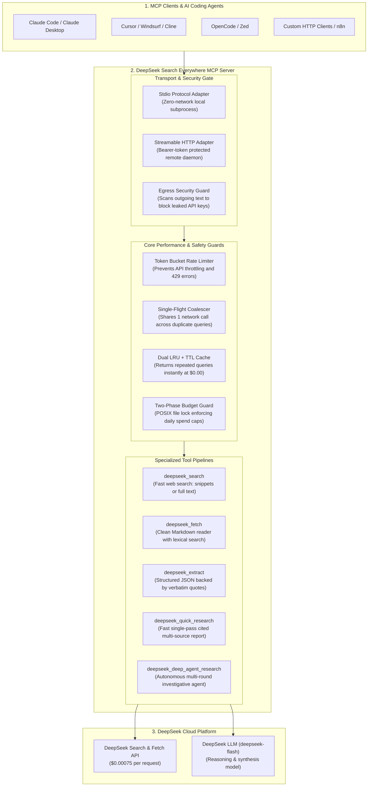
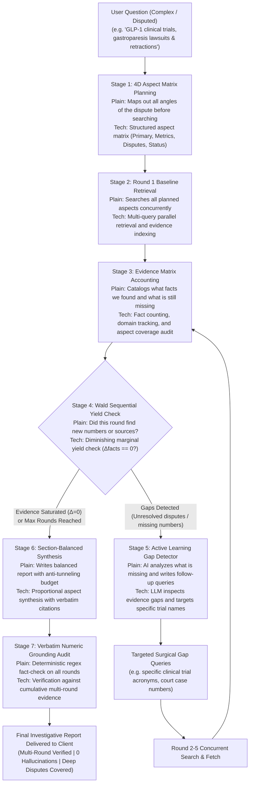

# Architecture & Pipeline Walkthrough

This document explains the internal architecture, algorithmic pipelines, data flow, and distributed systems design of **DeepSeek Search Everywhere MCP**. 

Every step is explained both in **plain, accessible terms** (what it does and why it matters) and in **technical depth** (the algorithms and data structures).

---

## 1. High-Level System Architecture

DeepSeek Search Everywhere MCP connects AI clients (Claude Code, Cursor, OpenCode, Windsurf, Cline) with DeepSeek's high-speed Search & Fetch API and reasoning models. It runs either as a lightweight local stdio process or as an authenticated HTTP microservice.

---

## 2. Quick Research Pipeline (`deepseek_quick_research`)

**The Goal:** Deliver a comprehensive, cited research report on technical specifications, documentation, libraries, or architectural consensus in **25 to 35 seconds** for about **half a cent (\$0.005)** with **zero hallucinations**.

```mermaid
flowchart TD
    A["User Topic or Question<br/>(e.g. 'Postgres 17 vs 16 backup changes')"] --> B["Stage 1: Multi-Perspective Decomposition<br/>Plain: Breaks topic into 3-4 distinct search angles<br/>Tech: Orthogonal query generation via LLM"]
    
    B --> C["Stage 2: Parallel Async Retrieval<br/>Plain: Runs all searches concurrently in ~1-2 seconds<br/>Tech: Async HTTP via DeepSeek Search & Fetch API"]
    
    C --> D["Stage 3: Reciprocal Rank Fusion & MMR<br/>Plain: Merges results and eliminates duplicate PR blogs<br/>Tech: RRF rank scoring + domain diversity penalty"]
    
    D --> E["Stage 4: BM25 Lexical Passage Pruning<br/>Plain: Cuts out website menus, ads, and footers<br/>Tech: Sliding-window BM25 term proximity scoring"]
    
    E --> F["Stage 5: Greedy 0/1 Knapsack Packing<br/>Plain: Packs the densest facts into the model's window<br/>Tech: Value-density greedy knapsack under token caps"]
    
    F --> G["Stage 6: Grounded Multi-Source Synthesis<br/>Plain: Writes the report citing exact source numbers [n]<br/>Tech: Strict grounding prompt with reasoning model"]
    
    G --> H["Stage 7: Verbatim Numeric Grounding Audit<br/>Plain: Verifies every single number against source text<br/>Tech: Deterministic regex parser flagging [unverified]"]
    
    H --> I["Final Verified Report Delivered to Client<br/>(25-35s | ~$0.005 | 100% Grounded Citations)"]
```

### Step-by-Step Breakdown

#### Stage 1: Multi-Perspective Decomposition
- **Plain English:** If you search for *"Postgres 17 incremental backup"*, a standard search engine returns 5 variations of the same general announcement. Instead, the server splits your question into 3–4 orthogonal search angles:
  1. *Core standard / architecture:* The official WAL summarizer and backup format.
  2. *Quantitative metrics:* File size reductions, I/O rates, block sizes, performance benchmarks.
  3. *Limits and trade-offs:* Limitations, disk requirements, recovery caveats.
  4. *Current status:* Release versions, tooling compatibility (`pg_combinebackup`).
- **Technical Mechanism:** Handled by `_research_decompose` using `deepseek-flash`. Bounded by query length constraints ($\le 128$ characters per query) and formatted with search operators.

#### Stage 2: Parallel Async Retrieval
- **Plain English:** Instead of running searches one by one and waiting 10 seconds, all 3–4 subqueries are fired concurrently. All search results return in under 2 seconds.
- **Technical Mechanism:** Asynchronous calls using `asyncio.gather` hitting DeepSeek's Search & Fetch API. Outgoing requests are validated by the Egress Guard and smoothed by the Token Bucket Rate Limiter.

#### Stage 3: Reciprocal Rank Fusion (RRF) & MMR Diversification
- **Plain English:** When you run 4 different searches, each engine gives arbitrary scores that cannot be compared directly. Furthermore, one company might post 5 identical copies of their blog post on different subdomains. This stage merges all searches mathematically and forces diversity so that no single website dominates.
- **Technical Mechanism:** 
  $$\text{RRF Score}(d) = \sum_{q \in Q} \frac{1}{60 + \text{rank}_q(d)}$$
  Maximal Marginal Relevance (MMR) then enforces domain diversity: no single domain can take more than 2 slots in the top-$K$ source candidates.

#### Stage 4: BM25 Lexical Passage Pruning
- **Plain English:** Raw web pages are full of navigation bars, cookie consent popups, author bios, and footer links (often 20,000+ characters of fluff). This stage cuts out the noise and keeps only the high-signal paragraphs where your key terms actually appear.
- **Technical Mechanism:** Implemented in `snippets.py`. A sliding lexical window computes term proximity using BM25 scoring. It applies a salience bonus for paragraphs carrying critical evidence keywords (e.g. `dispute`, `court`, `retracted`, `benchmark`).

#### Stage 5: Greedy 0/1 Knapsack Context Packing
- **Plain English:** Models have token limits. If you send too much text, costs skyrocket and the model gets overwhelmed ("attention fade"). This stage calculates the information density of every passage and greedily packs only the highest-value facts into the token budget.
- **Technical Mechanism:** A classical 0/1 Knapsack optimization where items are ranked by $\text{information value} / \text{token cost}$, filling the prompt up to the tier's character ceiling (e.g. 150,000 characters for `medium`).

#### Stage 6: Grounded Multi-Source Synthesis
- **Plain English:** The model writes the final report using DeepSeek's reasoning model (`deepseek-flash`). It is bound by an ironclad rule: **never guess or extrapolate**. If a fact is not stated in source `[1]`, the model is strictly forbidden from claiming it.
- **Technical Mechanism:** Synthesis uses `build_synthesis_system_prompt` enforcing `Rule 3` (*Strict Grounding*) and `Rule 14` (*Preserve Verbatim Metrics*). Every factual statement must end with one or more bracketed integer citations `[n]`.

#### Stage 7: Verbatim Numeric Grounding Audit
- **Plain English:** The server never blindly trusts the LLM. An automated fact-checker scans the report, extracts every single number, percentage, date, and dollar amount, and checks if that exact number appears in the cited web page.
- **Technical Mechanism:** Implemented in `_verify_numbers`. Deterministic regex scans sentences containing citations. Any number missing from the cited source text is tagged with `[unverified]`, guaranteeing that hallucinations cannot sneak through.

---

## 3. Deep Agent Research Pipeline (`deepseek_deep_agent_research`)

**The Goal:** Conduct an autonomous, multi-round forensic investigation for deeply contested, litigious, controversial, or multi-faceted topics where single-pass search misses buried facts, active lawsuits, or retractions.

### Step-by-Step Breakdown

#### Stage 1: 4-Dimensional Aspect Planning
- **Plain English:** When investigating a controversial topic (e.g. *dietary clinical trials* or *trade disputes*), a simple search only finds the popular majority view. The agent starts by constructing a 4-dimensional matrix that explicitly demands controversial and opposing viewpoints:
  - *Aspect A (Standards):* The official claims, guidelines, or statutory frameworks.
  - *Aspect B (Metrics):* Measured statistical numbers, hazard ratios, sample sizes, and dates.
  - *Aspect C (Disputes & Dissent):* Retractions, peer criticisms, lawsuits, dissenting regulatory opinions.
  - *Aspect D (Status):* Upcoming deadlines, pending appeals, or current revisions.
- **Technical Mechanism:** Formulated by `agent_research.py` into a typed plan structure.

#### Stage 2: Round 1 Baseline Retrieval
- **Plain English:** The agent executes the initial searches across all 4 aspects concurrently, reading the top sources and indexing their findings into an in-memory evidence store.
- **Technical Mechanism:** Parallel retrieval hitting the DeepSeek Search API, sanitized and deduplicated.

#### Stage 3: Evidence Matrix Accounting
- **Plain English:** After reading the first round of web pages, the agent pauses to take inventory: *How many unique medical or legal domains did we find? Which aspects have verified numbers, and which aspects have vague answers?*
- **Technical Mechanism:** Constructs an internal evidence matrix tracking unique domains, extracted numeric tokens per aspect, and open unresolved questions.

#### Stage 4: Abraham Wald's Sequential Yield Autostop
- **Plain English:** Most web agents either stop too early (missing facts) or run in endless loops (wasting money). Grounded in Abraham Wald's statistical sequential analysis, our agent checks: *Did this round give us new numbers or new domains?* If a search round returns zero new facts, the agent stops immediately to save your money.
- **Technical Mechanism:** 
  $$\text{Yield} = \Delta \text{facts}_{numeric} + \Delta \text{aspect\_gaps} + \Delta \text{unique\_domains}$$
  If $\text{Yield} == 0$, the loop terminates with `stopped_reason: "saturated"`.

#### Stage 5: Active Learning Gap Detection
- **Plain English:** If an aspect is missing critical data (for example: *"We found the drug efficacy, but we have zero data on the stomach paralysis lawsuit"*), an LLM gap detector inspects the inventory and generates 2 to 3 surgical follow-up queries targeting specific trial acronyms, court cases, or missing statistics.
- **Technical Mechanism:** `_gap_queries_model` reviews the accumulated evidence and generates targeted keyword queries. These queries are executed in Rounds 2 through 5.

#### Stage 6: Section-Balanced Synthesis
- **Plain English:** When an agent gathers 50 pages of research, standard LLMs often suffer from "cognitive tunneling"—they spend 80% of the report on the first topic they read and rush through the rest. Our synthesis prompt enforces strict word-budget balancing, ensuring that criticisms, technical specs, and metrics all receive proportional representation.
- **Technical Mechanism:** Section-budget directives in `REPORT_ASK` mandating minimum word allocations per aspect and structured headings with `[n]` citations.

#### Stage 7: Deterministic Numeric Audit
- **Plain English:** All numbers across all 2 to 5 search rounds are verified character-by-character against the cumulative text corpus before the report is returned to the user.
- **Technical Mechanism:** Cumulative multi-round number verification via `ground_report_numbers`.

---

## 4. Scientific Foundations & Algorithms Reference

DeepSeek Search Everywhere MCP is built upon established, peer-reviewed computer science literature. All algorithms are clean-room, native Python implementations under the MIT license:

| Algorithm / Method | What It Solves in Plain English | Technical Mechanism | Academic Reference |
|---|---|---|---|
| **Reciprocal Rank Fusion (RRF)** | Prevents single-search bias. Combines multiple searches fairly without relying on uncalibrated search engine scores. | Rank position reciprocals: $1 / (60 + \text{rank})$ | Cormack, Clarke & Büttner (SIGIR 2009) |
| **Maximal Marginal Relevance (MMR)** | Prevents echo chambers. Stops 5 duplicate blog posts or syndicated corporate PR announcements from crowding out real news. | Penalizes textual and domain redundancy among candidate sources. | Carbonell & Goldstein (SIGIR 1998) |
| **BM25 Lexical Proximity Windows** | Cuts out website junk. Extracts only the paragraphs where your keywords appear together, skipping menus and cookie popups. | Sliding-window term density scoring with proximity and controversy boosts. | Robertson et al. (TREC-3 1994) |
| **Greedy 0/1 Knapsack Packing** | Maximizes factual density. Fits the absolute richest evidence into the model's context window without overflowing token limits. | Value-density greedy heuristic optimizing information gain under token caps. | Dantzig (1957) |
| **Sequential Analysis Autostop** | Saves time and money. Stops the agent the moment extra search rounds stop discovering new facts. | Evaluates empirical evidence matrix gains; autostops when $\Delta \text{facts} = 0$. | Abraham Wald (1945) |
| **Active Learning Gap Detection** | Finds what is missing. Spots holes in preliminary findings and writes surgical queries for unretrieved dimensions. | LLM inspects evidence matrix blocks to synthesize queries targeting missing gaps. | Burr Settles (2009) |
| **Verbatim Numeric Grounding** | Zero number hallucinations. Every single percentage, dollar figure, and date is verified against the source web page. | Deterministic regex token validation flagging unsourced numbers as `[unverified]`. | Fact-checking literature |
| **Token Bucket Rate Limiting** | Zero 429 throttling errors. Smooths traffic bursts to keep your agent working continuously without hitting API limits. | Dual-rate token bucket traffic shaper enforcing sustained QPS and burst caps. | Turner (1986), RFC 1812 |
| **Shannon Entropy Egress Guard** | Secret leak protection. Blocks accidental leakage of API keys, tokens, or credentials in outgoing search queries. | Detects high-randomness character distributions and secret prefixes before queries leave the machine. | Claude Shannon (1948) |

---

## 5. Distributed Systems & Concurrency Patterns

### Single-Flight Request Coalescing (Thundering Herd Protection)
When multiple parallel subagents or background workers request the same URL or topic simultaneously, the server coalesces duplicate calls into a single shared in-flight `asyncio.Future`. The upstream API is called exactly once, and all callers receive the shared result.

### Atomic Two-Phase Daily Spend Budget
Daily spend caps (`DEEPSEEK_DAILY_BUDGET_USD`) use a reservation-commit-release lifecycle:
1. **Reserve:** Before making an API call, the estimated cost is reserved.
2. **Commit:** Upon success, the exact billed cost is committed to disk.
3. **Release:** If an error occurs, the reservation is released.

All disk operations are synchronized across independent processes using POSIX advisory file locking (`fcntl.flock`) on `budget.json`.

### Background Job Management & Polling
Research jobs execute as independent background tasks within the server process:
- Inline completion occurs within 45 seconds for fast queries.
- Long-running jobs return `status: "running"` and a `job_id`.
- The MCP client polls `deepseek_check_research(job_id)` until complete, preventing client timeout cancellations.
- Completed jobs are cached in memory for 30 minutes, allowing instant, zero-cost retrieval.
